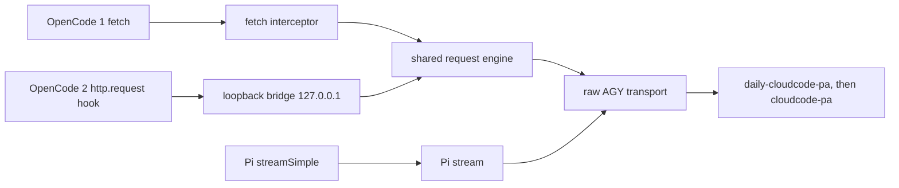

# Architecture

antigravity-auth lets OpenCode and Pi send model requests through Google's Antigravity backend, the service behind Google's `agy` CLI. Antigravity serves Gemini, Claude and GPT-OSS models through one Gemini-shaped API, billed against each Google account's Antigravity quota. The plugin signs requests with Google accounts, builds the exact request shape the `agy` CLI sends, picks an account for each request, and turns Antigravity's stream back into what the host expects.

It runs in three hosts from three npm packages:

- **OpenCode 1.x** (1.18.4 and later) and **OpenCode 2** (2.0.22 and later), from one package, `@cortexkit/opencode-antigravity-auth` (`packages/opencode`). Each host line has its own adapter over a shared request engine.
- **Pi**, from `@cortexkit/pi-antigravity-auth` (`packages/pi`).
- Both depend on `@cortexkit/antigravity-auth-core` (`packages/core`): account handling, OAuth, the raw transport, request transforms, quota and the model catalog. Core never imports a host SDK.

All three register under the host's `google` provider (`ANTIGRAVITY_PROVIDER_ID` in `packages/core/src/constants.ts`). The models the plugin serves are named `antigravity-…`, for example `google/antigravity-gemini-3.8-flash`.

## Terms

- **V1 / GA:** OpenCode 1.x and OpenCode 2. GA is OpenCode 2's generally available plugin API. Code under `packages/opencode/src/ga/` is OpenCode 2 only.
- **Local mode:** accounts the user signed into with Google OAuth, kept in the plugin's account store on disk.
- **Vault mode:** accounts served by Claustrum, the CortexKit credential vault, after the operator approves this host's enrollment. No refresh token is stored locally; each request gets a fresh access token from the vault.
- **Host mode:** vault accounts provided by Thalamus, the CortexKit agent runner, to the hosts it starts. Thalamus sets `CORTEXKIT_VAULT_HOST=thalamus` and installs a vault client accessor; the plugin needs no enrollment of its own.
- **Authority:** the per-operation answer to "which accounts may this use?": `local`, `vault`, `host` or `unreadable`. It comes from common-auth's `vaultAuthority` (`packages/core/src/vault-enrollment-authority.ts`). Anything but `local` excludes local accounts.
- **Placeholder:** a non-secret marker credential installed in the host's `google` auth slot in vault or host mode, so the host routes requests to the plugin without holding a real key.
- **Owned request:** on OpenCode 2, a Google request the plugin handles, recognised by its placeholder API key. Other Google requests pass through untouched.
- **Receipt:** what the vault returns for one send: access token, credential and record identity, project data and an identity assertion.
- **Account store:** the local accounts' durable home, a lease-locked store from common-auth, laid out as a pointer file plus *generation* folders.
- **Quota group:** a pool of Antigravity quota an account draws from: `gemini`, `non-gemini` (Claude and GPT-OSS, `3p` on the wire), and on accounts that report it, `gemini-argon`. Each group has a 5-hour and a weekly window.
- **common-auth:** the CortexKit library shared by the auth plugins (OpenAI, Anthropic, Antigravity, Claustrum). This repository embeds a pinned copy instead of depending on it at runtime (see "The embedded common-auth library").
- **MOTOR:** the CortexKit Linux build service. The native-inert release gate runs there.

## How a request flows

The three hosts reach the same wire format by different routes.

- **OpenCode 1** calls the plugin's `auth.loader`, which returns a fetch function (`packages/opencode/src/plugin/auth-loader.ts`, `fetch-interceptor.ts`). The loader reads authority, then binds either the local or the vault runtime.
- **OpenCode 2** dispatches every request through its own HTTP client, so a plugin can't return a response directly. The plugin's `http.request` hook (`packages/opencode/src/ga/server/index.ts`) checks ownership, records the request as a bridge job, and rewrites its URL to a loopback HTTP server the plugin runs on `127.0.0.1`. That server runs the shared engine and streams the reply back to the host. The hook refuses an owned request for a model outside the catalog with a message naming the matching `antigravity-` model; it never remaps a model.
- **Both OpenCode lines** use one engine, `createRequestExecutor` in `packages/opencode/src/plugin/shared/request-services.ts`. Per attempt it: reads authority, picks an account (see "Accounts" and "Quota"), gets credentials (refreshing a local token, or admitting a vault receipt), prepares the request, sends it, and classifies the result. It retries capacity errors across endpoints, rotates accounts on rate limits and access refusals, and handles a vault 401 by re-admitting once.
- **Pi** registers a provider whose `streamSimple` (`packages/pi/src/stream.ts`) converts Pi's context (`convert.ts`), sends it and parses the SSE stream. Pi serves exactly one account: its own local login, or one vault account.

**Request preparation** (`packages/opencode/src/plugin/request.ts` with the transforms in `packages/core/src/transform/`):
- resolves the model and its thinking tier;
- strips foreign thinking metadata after a model switch;
- converts tool schemas to Gemini's uppercase-typed schema;
- builds the `agy` CLI's request metadata (conversation, trajectory and step ids, `packages/core/src/agy-request-metadata.ts`);
- orders the payload keys as the CLI does;
- appends a `[Continue]` user turn when the history ends on a model turn, because Antigravity rejects that.

Title requests for a model the plugin doesn't serve go to `gemini-3.8-flash-low`.

**Transport.** `packages/core/src/agy-transport.ts` is a raw HTTP/1.1 TLS client (direct or through an HTTPS proxy), because Antigravity checks header order and serialization that `fetch` doesn't control. It has a 180 s response-header deadline and a 180 s idle deadline that resets on every byte. The engine adds a 600 s pre-response deadline across all attempts (`packages/core/src/pre-response-deadline.ts`). Content tries the daily host, then production (`ANTIGRAVITY_ENDPOINT_FALLBACKS`); quota reads use only the daily host, because the two hosts can report different Gemini pools.

**Responses** (`packages/opencode/src/plugin/core/streaming/transformer.ts`): the plugin unwraps Antigravity's envelope, carries thinking signatures to the next request through a signature cache, merges usage, and ends the stream after the first candidate with a finish reason and a complete SSE frame.

**Failures** come back as native errors, never as a fake successful reply. Policy refusals use HTTP 412 with static text and a truthful `Retry-After`. That text never contains a number like 429 or 5xx, because OpenCode 1 retries any error whose text matches those. On OpenCode 2 the plugin's retry hook (`decideGaRetry`) tells the host not to retry an owned request, since the engine has already rotated and retried.

## Accounts and credentials

Authority is read at the start of each unit of work, and again before a credential is used. `vault`, `host` and `unreadable` keep local accounts dormant: no local reads, token refreshes, quota polls or sidebar writes. A vault request never falls back to local accounts.

**Local mode.**
- Sign-in uses Google OAuth with PKCE. The callback listens on `http://localhost:51121/oauth-callback`, or the user pastes the URL in headless or WSL environments (`packages/core/src/antigravity/oauth.ts`, `packages/opencode/src/plugin/server.ts`).
- The refresh token, project id and managed project id are packed into one string.
- An access token is refreshed when a request finds it within 60 s of expiry. A background queue checks every 5 minutes and refreshes tokens within 30 minutes of expiry (`refresh-queue.ts`, `proactive_refresh_*` settings).
- An `invalid_grant` refresh error removes the account.
- Account selection, rate limits and per-model refusals live in `packages/core/src/account-manager.ts` and `account-selector.ts`. Sessions are pinned to an account, and child sessions prefer a different account from their parent.

**Vault mode.**
- `packages/core/src/vault-account-source.ts` wraps common-auth's Claustrum consumer. It lists the vault roster, and admits one receipt per send with a 5-minute minimum token lifetime. It reports a final 401 to the vault.
- While the vault is unreachable, the last good receipt is served from memory until its token expires. An explicit refusal, a roster removal or a 401 drops it.
- OpenCode keeps one shared custody per process and vault folder (`packages/opencode/src/plugin/vault-custody.ts`, `ga-shared-vault-custody.ts`). A stalled first roster read is recycled after 30 s.
- Enrollment is set up with `antigravity-auth setup --claustrum` or the `/antigravity` menu, and approved by the operator in Claustrum.

**Host mode** (`CORTEXKIT_VAULT_HOST=thalamus`).
- The consumer connects through `globalThis[Symbol.for('cortexkit.vault')]('antigravity-auth')` instead of a connection file and token. Each call returns a new client that its caller closes.
- If the accessor is missing or throws, the vault counts as unreachable, never as local mode.
- Setup refuses to start an enrollment, and the menus show "Served by Thalamus" with no Connect or Disconnect.

**Host slots.**
- **OpenCode 1** needs some saved `google` auth record before it loads the provider at all. In vault and host mode the plugin never reads or refreshes that record.
- **OpenCode 2** owns a request only when its prepared `x-goog-api-key` equals common-auth's `placeholderSecret('google')`. The "Use approved Antigravity vault" login installs that placeholder.
- **Pi** saves its native `google` login in a stash and installs the placeholder, holding Pi's `auth.json` lock (common-auth `pi-slot`). It restores the saved login on leaving vault or host mode, only if the slot still holds the placeholder. If startup can't reach a consistent state, Pi registers a refusing `google` provider and keeps `/antigravity` for recovery.

## Storage and files

The plugin keeps its files out of OpenCode's config folder, because OpenCode watches that folder. Per OpenCode config folder there is one runtime folder under `$XDG_STATE_HOME/cortexkit/antigravity-auth/` (default `~/.local/state/…`): `opencode/` for `~/.config/opencode`, and `opencode-<16 hex of sha256 of the folder's identity>/` for any other, with `config-dir.json` naming its owner (`packages/opencode/src/runtime-paths.ts`).

| File | Where | Notes |
| --- | --- | --- |
| Account store | runtime folder, `antigravity-accounts.json` pointer plus generation folders | Moved from the config folder on the first local opening. A forwarding pointer stays in the config folder for good. |
| Vault files | runtime folder, `antigravity-auth-vault/` | Enrollment token and state, roster, provider state and quota. `OPENCODE_ANTIGRAVITY_AUTH_VAULT_DIR` (absolute) overrides it and is never moved. |
| Layout marker | runtime folder, `layout.json` | Records that this folder's files were moved. |
| Sidebar snapshot | `…/antigravity-auth/sidebar-state.json` | OpenCode 1 only; redacted. `ANTIGRAVITY_AUTH_SIDEBAR_STATE_FILE` overrides it. |
| Signature cache | `…/antigravity-auth/antigravity-signature-cache.json` | Shared by all config folders. |
| Debug logs | `…/antigravity-auth/logs/` | `OPENCODE_ANTIGRAVITY_LOG_DIR`, then `log_dir`, override it. |
| Process heartbeats | `…/antigravity-auth/processes/<pid>.json` | Let a newer version see which older ones are running. |
| Status-server port files | `…/antigravity-auth/rpc/<16 hex of project path>/port-<pid>.json` | OpenCode 1 only. `ANTIGRAVITY_AUTH_RPC_DIR` overrides it. |
| Settings | OpenCode config folder `antigravity.json`, project `.opencode/antigravity.json`, `tui-preferences.jsonc` | Stay in the config folder. |
| Pi | Pi's agent folder (`PI_AGENT_DIR`, default `~/.pi/agent`): `antigravity-auth-vault/` with `pi-mode.json` and `pi-roster.json`, plus the `google` slot in Pi's own `auth.json` | Unaffected by the OpenCode layout. |

**Moves are fenced.** A move runs under a layout lock, and only when the heartbeats and port files show no older or unknown process using the old layout (`version-fence.ts`). A heartbeat left behind by a crash or reboot stops counting once its start time is before the last boot. After the vault move, only the enrollment token is deleted from the old folder. The old approved state is left behind, so an older version reads "approved, token missing" and refuses instead of falling back to local accounts.

**The account store** records its own absolute path in its journal and generation files, so it can't simply be copied. The move rebuilds it in the runtime folder using the store's crash-safe migration steps, and leaves a forwarding pointer behind. `antigravity-auth store relocate --back --offline` moves it back, and is required before downgrading to 3.0.15 or earlier. Deleting the forwarding pointer by hand is the one way to make an older version see no accounts. Request-path reads of the store are lock-free: they stamp the files, read, re-stamp, retry up to three times, and then refuse as "busy".

**When the layout can't be settled** (a conflict, a damaged marker or a lock timeout), the process serves neither vault nor local accounts for its whole life, with a message specific to the cause.

## Quota, selection and limits

**Quota readings** come from Antigravity's quota endpoint on the daily host (`packages/core/src/quota-manager.ts`). Buckets map to groups:
- `gemini-5h`, `gemini-weekly` → `gemini`;
- `3p-5h`, `3p-weekly` → `non-gemini`;
- `gemini-argon-wtu-weekly` → `gemini-argon`.

An Argon model counts against `gemini-argon` only on accounts that report that bucket, and against `gemini` elsewhere. Every reading keeps its own observation time, and an undated reading is never treated as current.

**Where readings come from:**
- in local mode, a background poller (`background-quota-refresh.ts`);
- in vault mode, insula first, the shared CortexKit quota service, then the plugin's own daily-host read through the receipt (`background-vault-quota-refresh.ts`, `vault-insula-quota.ts`).

Pollers coordinate across processes with a freshness check and an advisory lock.

**Selection.** `account_selection_strategy` is `hybrid` by default (health, token balance and freshness, with stickiness), or `sticky` or `round-robin` (`packages/core/src/rotation.ts`). The engine skips accounts that are cooling down, rate-limited for that family and model, ineligible, below the killswitch floor, or below the soft-quota threshold.
- **Soft quota** (`soft_quota_threshold_percent`) is off by default (100), and never applies to a single account.
- **The killswitch** (operator setting, off by default, 5% floor) is model-aware.
- Missing or stale quota never excludes an account.
- When no account can serve, the engine waits for the earliest one, within `max_rate_limit_wait_seconds` (default 300), or refuses with 412.

**Remembered refusals.** A structured `NOT_FOUND` for a model marks that account as unable to serve that model for an hour, or until a new quota reading. This is per request engine.

**Routing.** In vault mode on OpenCode, when Claustrum's routing service is present (`cortexkit.routing` accessor), the engine asks it which account a session's first primary request should use. It falls back to its own choice when routing is late or names an unusable account. It reports `served` after a clean finish, and `exhausted` (with `pool` and window) only for a `QUOTA_EXHAUSTED` 429 backed by a dated 0% reading (`packages/opencode/src/plugin/shared/vault-routing.ts`).

## Renderers

The sidebar and menus never see credentials. Build tests check the renderer import graphs and refuse credential and store modules (`packages/opencode/scripts/build-tui.ts`).
- **OpenCode 1:**
  - the sidebar polls the redacted `sidebar-state.json` (`packages/opencode/src/sidebar-state.ts`, contract in `packages/opencode/docs/sidebar-contract.md`);
  - the `/antigravity` menu talks to the server over an authenticated loopback status server, with the port and bearer in an owner-only port file (`packages/opencode/src/rpc/`).
- **OpenCode 2:** the TUI (`packages/opencode/src/ga/tui/host-ga.tsx`) talks to the server over the host's location-scoped plugin RPC (`packages/opencode/src/ga/rpc/protocol.ts`).
- **Both** draw quota with common-auth's shared sidebar frame (`packages/opencode/src/tui/sidebar-frame.tsx`). The `./tui` export (`packages/opencode/src/tui/entry.mjs`) loads only the renderer its host asks for.
- **Pi** has no sidebar; it has the `/antigravity` command.

## The embedded common-auth library

Each of `packages/core/src/common-auth-embedded/` and `packages/opencode/src/common-auth-embedded/` holds the public modules of one pinned common-auth release, copied from its npm archive in `tools/common-auth-build/inputs/`. Their provenance is in `source-output.json`.

The library is embedded so that each release ships exactly the library bytes it was tested with, and so the renderers can compile its sidebar source with this package's own TUI build. `bun run embed:check` (`packages/opencode/scripts/embed-common-auth.ts`) verifies the archive, the file list and every byte. A new version is adopted by checking the candidate on a branch that is never merged, then embedding the published archive.

## Invariants

1. **Vault, host and unreadable authority exclude local accounts**, with no fallback. Enforced by the vault and custody tests and the Windows vault job (`test/windows-vault/`), which counts local reads.
2. **Renderers never import credential or store code.** Enforced by the import-graph tests in `packages/opencode/scripts/build-tui.test.ts`.
3. **OpenCode 2 ownership is decided by the placeholder header alone**, never by the active connection. Enforced by `isGaOwnedRequest` and the GA server tests.
4. **Every outbound request ends in a user turn.** Enforced by request preparation and its tests.
5. **Failures are native errors**, and plugin refusal text carries no 429/5xx digit runs. Enforced by request-services and GA tests.
6. **Quota reads use only the daily host.** Enforced by `ANTIGRAVITY_QUOTA_ENDPOINT` and the quota tests.
7. **Request-path store reads take no exclusive lock.** Enforced by the store admission tests.
8. **Embedded library bytes equal the pinned archive.** Enforced by `embed:check`, which runs before build, typecheck and test.
9. **Tests never touch the operator's profile.** `test/setup.ts` gives every test its own HOME and XDG folders and clears `CORTEXKIT_VAULT_HOST`. OpenCode 2 host tests set an isolated `OPENCODE_DB` (`test/environment.test.ts`).
10. **Only a version-only commit is tagged,** and only with a native-inert gate record for exactly that commit (`scripts/release.sh`).

## Tests and gates

- `bun run test`: the unit and contract suites. It runs the embedding check and the core build first. Never run bare `bun test` at the root.
- `bun run test:e2e`: plugin, CLI and RPC flows against a mock Antigravity server, with a loopback-only fetch guard.
- `bun run test:e2e:opencode-v2`: the pinned official OpenCode 2 binary in Docker with `--network none`.
- `bun run smoke:tui`: installs the packed package into a fresh consumer and loads both renderers.
- **CI** (`.github/workflows/ci.yml`): typecheck, build, TUI smoke, unit, e2e, the OpenCode 2 Docker smoke, format and lint, plus the status-server contracts on Node 20, Node 24, Bun 1.3.14 and Bun 1.4.2. **Windows** (`windows-migration.yml`) runs store migration, relocation and real vault enrollment on two Windows versions.
- `bun run test:native-inert`: the release gate, run on MOTOR Linux. It runs the toolchain checks, the core build, the strict typechecks, a scoped lint, and the portable and MOTOR test suites. It only cleans up processes inside a verified private sandbox, and refuses everywhere else.
- `bun run prepush`: the local gate before pushing (`scripts/prepush.sh`). The fast phase runs frozen installs, the embedding checks, format, lint and four repo guards: the disk-test list, the renderer import graph, synchronous spawns and shell exit traps. The full phase then runs typecheck, build, the TUI smoke, `test` and `test:e2e` in one MOTOR job (`--full-here` runs it on the current machine).

**Releasing:**
1. `scripts/release.sh --prepare <version>` makes the version-only commit.
2. `bun run test:native-inert` runs the gate, and `scripts/record-native-inert-gate.ts` records it.
3. CI and Windows must pass on that exact commit.
4. `scripts/release.sh <version>` checks all of that and pushes only the tag. The tag starts `.github/workflows/release.yml`, which tests, publishes the three packages to npm with provenance, and creates the GitHub release.
