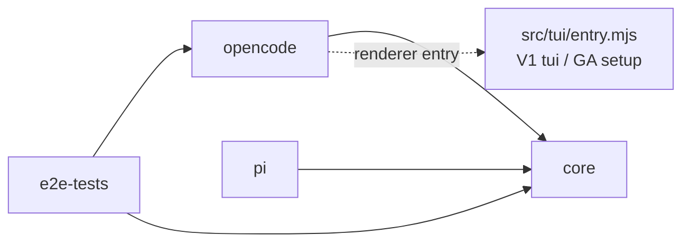
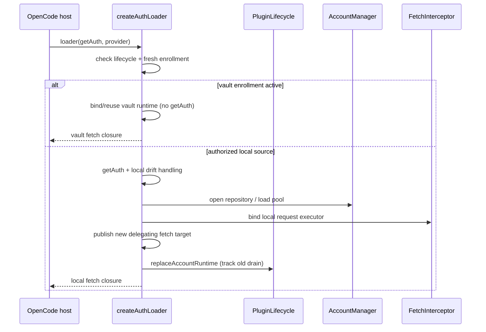
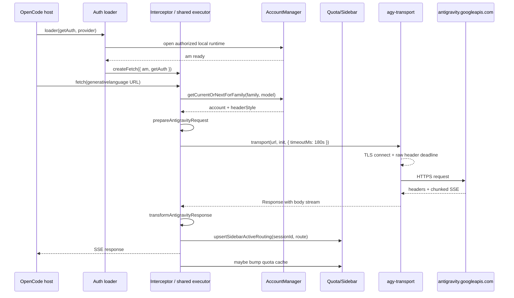
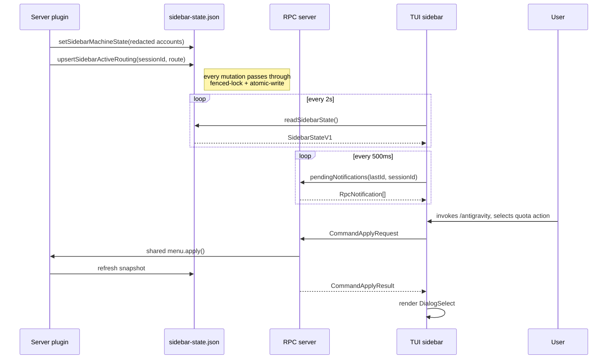
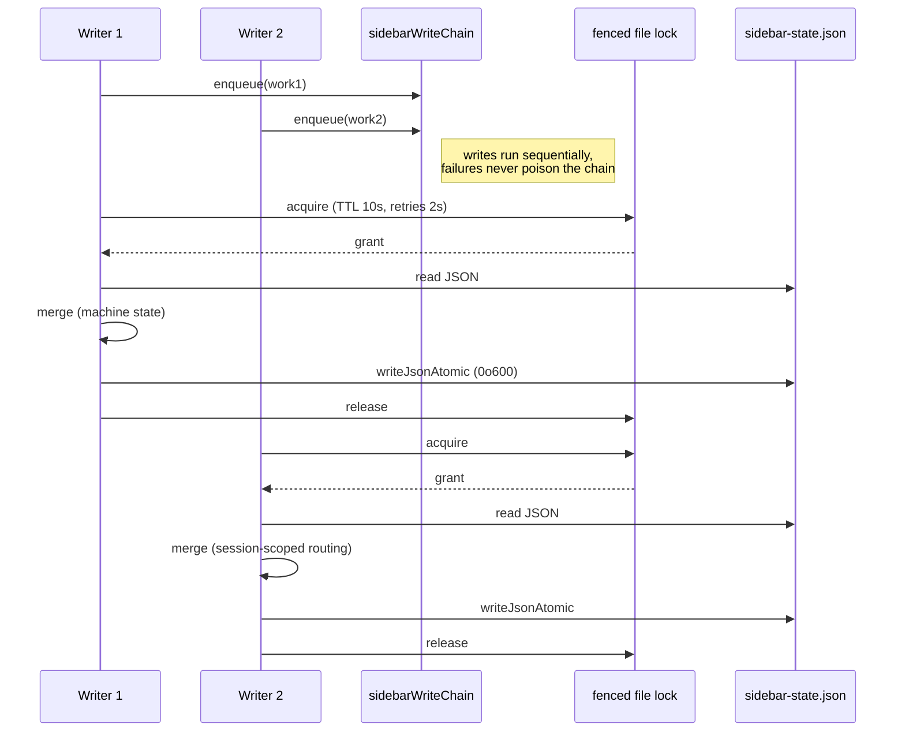
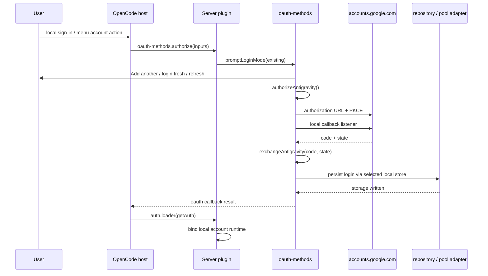

# Architecture

This document maps the current `@cortexkit/antigravity-auth*` source tree: shared core, the unified OpenCode 1.x / OpenCode 2 server and TUI package, and the Pi extension. Manifests and source are authoritative.

**Terminology:** V1 means OpenCode 1.x; GA means OpenCode 2's generally available plugin API. A local source uses the account repository/pool on disk; a vault source uses an approved enrollment and fresh remote credentials. Enrollment authority is the freshly read choice between local, vault and unreadable state. A native `google` slot is the host's saved auth record; custody uses a non-secret placeholder while retaining the prior login for safe restoration where that host supports it.

The verification commands below distinguish source tests from **packed** checks (tarballs installed into a consumer) and **native** checks (an actual host executable, not a mock). Listing a command is not a claim that CI, release, vault activation or installed OpenCode 1.x execution has passed.

## System goals and boundaries

The stack solves three problems at the harness boundary:

1. **Let non-Google harnesses talk to Antigravity.** OpenCode 1 binds a custom fetch, OpenCode 2 GA rewrites host requests to an adapter-owned loopback server, and Pi registers a custom provider. The adapters build the AGY request envelope and transform the SSE response for the host.
2. **Manage account selection and credentials.** Local accounts retain refresh/project identity, fingerprints and dated quota state; vault selection state remains credential-free and acquires credentials per send. Rotation, cooldown and persistence sit behind the host provider boundary.
3. **Render account status without competing for the host's terminal.** V1 publishes a redacted file snapshot and uses loopback RPC for its menu; GA has location-scoped RPC and a native TUI setup arm. Both renderers leave terminal ownership to the host.

Explicit boundaries:

- **Core is harness-agnostic.** It owns account, transport, OAuth, repository and vault primitives, not host SDK calls. OpenCode's `PluginDependencyOverrides` supplies the V1 host/network seam; GA and Pi have their own composition seams.
- **Renderers do not execute credential pipelines.** `packages/opencode/src/tui.tsx` and `src/ga/tui/host-ga.tsx` consume redacted state and menu/RPC contracts. Account storage, OAuth and request execution stay server-side. UI actions request server operations rather than handling tokens in the renderer.
- **Host contexts are not an in-memory sharing contract.** V1's file snapshot and loopback RPC, and GA's location-scoped RPC, are the communication boundaries. Do not infer one shared process from the fact that both arms ship in one package.

## Package and process topology

Three publishable packages plus a private e2e workspace:

```
antigravity-auth/
├── packages/
│   ├── core/                 # @cortexkit/antigravity-auth-core — harness-agnostic
│   ├── opencode/             # @cortexkit/opencode-antigravity-auth — V1 + GA server/TUI
│   ├── pi/                   # @cortexkit/pi-antigravity-auth — pi extension
│   └── e2e-tests/            # private: black-box flows against a mock loopback server
├── scripts/                  # build, dev, schema, smoke
└── package.json              # root monorepo script surface
```

The dependency direction is strictly one-way:



`packages/opencode/package.json` exports `.`, `./server`, and `./tui`; there is no public `./rpc` export. The root remains the V1 plugin barrel. `src/server.ts` supplies a hybrid default with GA `id`/`setup` and V1 `server`. `src/tui/entry.mjs` supplies a real hybrid default with V1 `tui` and GA `setup`, loading only the selected renderer on first call. The Pi manifest declares `pi.extensions: ['./dist/index.js']`. Both host packages depend on core, never the reverse.

### V1 process/context topology

```mermaid
flowchart LR
  subgraph OCHost[OpenCode server context]
    direction TB
    ServerPlugin[server plugin<br/>createAntigravityPlugin]
  end
  subgraph Sidecar[OpenCode TUI context]
    direction TB
    FileLogger[tui file logger]
    TuiPlugin[TUI plugin<br/>src/tui.tsx]
  end
  subgraph Child[server-owned runtime]
    direction LR
    Interceptor[createFetchInterceptor]
    QuotaMgr[createOpenCodeQuotaManager]
    AccMgr[AccountManager]
    RPC[RPC server]
  end
  ServerPlugin --> Interceptor
  ServerPlugin --> QuotaMgr
  ServerPlugin --> AccMgr
  ServerPlugin --> RPC
  TuiPlugin -. poll file .-> SidebarState[sidebar-state.json]
  SidebarState ~~~ RPC
  RPC -. 127.0.0.1:port + Bearer .-> TuiPlugin
  Interceptor --> AGY[Antigravity HTTPS]
  QuotaMgr --> AGY
  AccMgr --> Storage[(local repository / pool file)]
  RPC --> Notif[notification queue]
```

The V1 TUI discovers the server through a per-pid port file. The hybrid loader delegates runtime-module probing to embedded common-auth's `loadTui`: a host runtime selects the compiled tree; the raw tree is the development fallback. Unrelated import failures propagate rather than silently selecting another renderer.

## Core library layers

`packages/core/src/index.ts` is the public barrel. The manifest also exports embedded common-auth subpaths. Modules are grouped by concern:

| Layer | Module under `packages/core/src/` | Responsibility |
| --- | --- | --- |
| OAuth | `antigravity/oauth.ts`, `auth.ts` | PKCE, token exchange/refresh, packed project fields, expiry buffer |
| Transport | `agy-transport.ts`, `fetch-timeout.ts` | Raw TLS, chunked/gzip decode, header/idle timeouts; stream-safe standard fetch timeout |
| Quota | `quota-manager.ts`, `quota-presentation.ts` | Attributed fetch, bounded backoff, in-flight dedupe, dated quota presentation |
| Accounts | `account-manager.ts`, `account-selector.ts` | Selection, rate-limit state, fingerprints, soft-quota, persistence transitions |
| Repository | `account-repository.ts`, `account-repository-codecs.ts`, `account-repository-types.ts`, `account-migration.ts` | Lease-backed records, account/credential separation, legacy migration |
| Pool file | `account-storage.ts`, `account-types.ts` | V4 JSON compatibility/storage path |
| Rotation | `rotation.ts` | Health score, token bucket, hybrid selection |
| File primitives | `file-lock.ts`, `atomic-write.ts` | Renewable fenced lock, temp + rename, ownership-loss signals |
| Vault | `vault-enrollment-authority.ts`, `vault-account-source.ts`, `vault-provider-state.ts` | Fresh enrollment authority, credential-free selection, per-send vault credentials |
| Common-auth | `common-auth-runtime.ts`, `common-auth-embedded/` | Lazy embedded public modules, store/lease, commands, routing, quota and Pi slot helpers |
| Request context | `fingerprint.ts`, `project.ts`, `agy-request-metadata.ts` | Device identity, project resolution, conversation/trajectory IDs and payload order |
| Catalog / logging | `model-registry.ts`, `constants.ts`, `logger.ts` | Models, endpoints, scopes, headers, structured logging |

OpenCode's `src/plugin/storage.ts` resolves host paths and opens the local repository; the pool-file adapter remains available. The repository uses attributed row operations rather than treating every update as a whole JSON-pool rewrite.

### Layer dependency rules

Core exposes harness-agnostic primitives and lazy public common-auth capabilities. Host-specific request execution, SDK calls, UI rendering and side effects are composed by OpenCode or Pi, above that boundary. Token parsing is reusable across hosts; neither core storage nor selection depends on an OpenCode renderer.

## OpenCode V1 server plugin

### Composition root

`packages/opencode/src/plugin/index.ts` defines `createAntigravityPlugin(providerId, options)`. The package barrel `packages/opencode/index.ts` re-exports `AntigravityCLIOAuthPlugin` and `GoogleOAuthPlugin`, bound to provider `google`. This is the V1 composition root, not the only host entry in the unified package.

The factory composes a dependency bag (`fetchImpl`, `agyTransport`, filesystem roots, OAuth and clock), configuration, health/token trackers, disk signature cache, session registry, lifecycle, quota manager, operator settings, event/recovery/update hooks, account/OAuth services, auth loader, shared command menu and RPC. Local quota polling and proactive refresh are authorized local producers, not vault-mode background work. The returned `PluginResult` includes `dispose`, config/command/event/tool hooks and `auth`. The host chooses when to invoke the loader; it is not a claim that the loader runs once per model request.

### Auth loader and source-aware fetch

`packages/opencode/src/plugin/auth-loader.ts` selects the source using fresh enrollment state and binds a fetch runtime. It caches repository opening and a separate lazy vault fetch runtime; the first authorized local request after vault use can reload local account state. Local auth drift repair and refresh belong only to the authorized local branch.



**OpenCode 1 dormant-login rule:** the host needs a saved `google` auth record before loading the provider. Once loaded, the plugin admits vault requests under [host enrollment approved by the Claustrum vault operator](packages/opencode/docs/VAULT.md#enroll-and-activate), not that saved record. An ordinary saved Google login, or a placeholder tied to another vault enrollment, remains unread, unvalidated and unrefreshed by the plugin while vault credentials serve. The plugin deliberately does not inspect which login or enrollment created the saved record: vault access is authorized by fresh approved enrollment, not by the dormant slot. OpenCode 1 does not apply OpenCode 2's per-request placeholder check. New local credential use, OAuth sign-in, and token refresh are blocked while vault mode is selected or enrollment state cannot be read.

### Fetch interceptor

`packages/opencode/src/plugin/fetch-interceptor.ts` binds V1 credentials and host effects to `src/plugin/shared/request-services.ts`. The shared `createRequestExecutor` owns selection, retry/quota/routing, endpoint fallback, warmups, transport and response handling; GA uses that engine too.

Key gates in the request lifecycle:

- Non-generative-language requests pass through to the captured host fetch.
- Local credentials refresh before expiry and resolve project context; vault sends acquire fresh credentials from the vault rather than refreshing the host slot.
- Request preparation sanitizes cross-model history, strips incompatible thinking blocks, stabilizes payload order, and injects fingerprints and metadata.
- The raw AGY transport supplies bounded socket/header/body behavior; the reverse transformer restores host SSE shape and usage/signature metadata.
- Terminal outcomes are native error responses or thrown exhaustion errors, never synthetic HTTP 200 assistant success text (see **Error handling**).

`RetryState` and `WarmupState` are per-runtime bookkeeping. Retirement stops new generative admission and drains admitted requests and response bodies; disposal aborts and awaits cleanup. Replacement must not cancel a response already handed to the host.

### Dependency seam

`packages/opencode/src/plugin/dependencies.ts` defines the V1 override surface. Tests inject fetch, AGY transport, filesystem roots, OAuth and clock; the e2e harness combines these seams with a loopback fetch guard. These source-level seams do not prove a packed host load path.

## OpenCode 2 GA server and location services

`packages/opencode/src/ga/server/index.ts` defines `createGaAntigravityPlugin`. GA's `session.hook('http.request')` contract rewrites a web-standard request rather than returning the plugin's response. The server binds an ephemeral loopback bridge, identifies pending jobs with unguessable IDs, and rewrites the host URL so normal host dispatch reaches the shared request executor. `src/ga/proxy-guard.ts` guards the loopback request boundary; `src/plugin/ga-location-services.ts` supplies location-owned account, menu and serving services.

The shared engine preserves the same wire invariants for both OpenCode arms: final requests with tools use `toolConfig.functionCallingConfig.mode: 'VALIDATED'` except the Gemini 4 Argon family, which omits `toolConfig` to match the native Low request in `test-fixtures/agy-cli-1.3.5/native-argon-low.json` (only Low is captured; omission for Medium/High is inferred because all three catalog rows describe the same Argon family, not separately observed on the wire). Requests remove `providerOptions`, strip image-model tools/thinking, append `[Continue]` after model-ending history, and preserve terminal SSE frames. `routeTitleModel` routes title work to a supported model rather than bypassing the adapter to Google's public endpoint.

Local GA service uses the lease-backed repository; vault service uses enrollment authority and fresh per-send grants. `ACCOUNT_INELIGIBLE` and `VALIDATION_REQUIRED` persist access state before rotation. Generic 403 responses are not rate limits. Stream EOF without a terminal candidate, embedded SSE errors and exhausted fallbacks surface as native failures, not successful assistant text.

`createGaAntigravityPlugin(overrides)` is the OpenCode 2 composition/test seam, exported from `./server`. Server disposal unregisters hooks and retires its account/menu services, pending jobs, streams, timers and loopback connections. The integration registers the pool browser login and approved-vault method under the saved connection label `Antigravity`; login methods and saved connections are distinct. Request ownership means which outgoing requests the adapter handles: it matches the host-prepared `x-goog-api-key` exactly to `placeholderSecret('google')` from `@cortexkit/common-auth` before body/model handling, without an active-connection or method-ID lookup. Real keys/native Google credentials pass through unchanged. Antigravity is the only supported plugin issuing that Google marker. Because the marker identifies the provider, not its producer, another plugin issuing the same marker cannot be distinguished and is outside this integration's supported scope. The freshly read enrollment state separately selects local or approved-vault credentials. See [OpenCode 2](packages/opencode/docs/OPENCODE-2.md).

**Server-only SDK profile:** the GA consumer fixture selects the installed `./server` API, checks its emitted declarations against the genuine `@opencode/plugin` SDK, and excludes installed host TUI frameworks. This is a test/type profile, not the package export topology. The public default is hybrid, `./tui` is a real renderer entry, and SDK imports in the server source are type-only.

`createGaLocationServicesFactory` retains separate lazy local and vault promises across enrollment changes, without rotating the RPC generation. Each operation checks current source authority. Local repository and executor construction are deferred until authorized local work needs them; failed construction may be retried. Menu source changes refresh the newly selected account view. Vault mode leaves local quota polling and token refresh dormant. V1 has its own custody-aware path retention/replacement and must not be described as this GA generation model.

## OpenTUI process and trust boundary

### Two halves of the contract

The `./tui` export is `packages/opencode/src/tui/entry.mjs`, a lazy `{ id, tui, setup }` default. V1 calls `tui`; GA calls `setup`. Each arm loads only its own root. Embedded common-auth's `loadTui` chooses runtime-compiled or raw output; a missing installed root or unrelated import failure is not hidden by a broad fallback.

The build emits separate raw/compiled trees for V1 and GA. Slim contracts include:

- `packages/opencode/src/sidebar-state.ts` — V1 snapshot reader/writer and redaction.
- `packages/opencode/src/tui-preferences.ts` — shared preferences reader and file watcher for TUI settings (`tui-preferences.jsonc`).
- `packages/opencode/src/rpc/protocol.ts` — type-only common-auth menu requests/results and notification envelopes.
- `packages/opencode/src/ga/rpc/protocol.ts` — GA location/menu RPC contract.
- `packages/opencode/src/rpc/rpc-client.ts` — the TUI's HTTP client.
- `packages/opencode/src/rpc/rpc-dir.ts` — resolves the per-project directory the port file lives in.
- `packages/opencode/src/quota-presentation.ts` — shared formatter projection without credential imports.

The render roots do not import the credential pipeline. `packages/opencode/scripts/build-tui.test.ts` checks the render import graph and build output; this is stronger evidence than a TypeScript type-only boundary alone.

### TUI render path

`packages/opencode/src/tui.tsx` is a `TuiPlugin` that registers a `slots.sidebar_content` slot. The slot renders a `SidebarPanel` Solid component that:

1. Polls `readSidebarState` every 2 seconds.
2. Polls RPC for shared menu and toast notifications.
3. Renders enabled/health/cooldown state, `gemini` and `non-gemini` quota pools, optional quota windows and captured tier.
4. Selects the sidebar session's route, or the newest route when no session ID is supplied.
5. Surfaces a stale-routing indicator when `routingAuthoritative` is false.

`tui/command-dialogs.tsx` renders the shared `/antigravity` menu with host dialog primitives. Common-auth commands own action dispatch, confirmation and invocation isolation; the renderer returns selected actions over RPC. GA's native TUI root is `src/ga/tui/host-ga.tsx`.

`plugin/command-data.ts` holds only the cached, privacy-safe account-row projection used in account OAuth replies; quota refresh and account mutations belong to the shared menu and its repository collaborators. Request dumps are controlled by the Diagnostics menu switch; there is no separate `/gemini-dump` command.

### File logger

`packages/opencode/src/tui/file-logger.ts` writes diagnostics to `<xdg-state>/cortexkit/antigravity-auth/tui.log` (mode 0o600, 1 MB tail-truncated), not stdout/stderr.

### RPC protocol

`packages/opencode/src/rpc/protocol.ts` re-exports common-auth's `CommandApplyRequest`, `CommandApplyResult` and `CommandDialogPayload` as types. Notifications are `{ id, payload, sessionId? }`, carrying a menu or toast; pending replies contain `{ messages: [...] }`.

`src/rpc/rpc-server.ts` wraps embedded common-auth's public RPC server and requires the parser from the same commands module that built the menu. Invalid apply bodies return 400 before action dispatch. It sets a 2-second receipt timeout and a 120-second apply deadline. Common-auth owns loopback binding, bearer checking, port-file publication and shutdown. `src/rpc/rpc-client.ts` discovers that port file and sends bearer-authenticated requests.

`src/rpc/notifications.ts` owns the bounded monotonic queue. Session-specific messages go only to their session; messages without a session ID are broadcasts. `isTuiConnected` uses a 5-second polling TTL.

### Port file discovery

`packages/opencode/src/rpc/port-file.ts` re-exports embedded common-auth discovery. Owner-only `port-<pid>.json` files carry `{ pid, port, token }`. Discovery validates entries and excludes dead owners; pid-scoped files avoid a single fixed port registration.

`packages/opencode/src/rpc/rpc-dir.ts` resolves the V1 directory: `ANTIGRAVITY_AUTH_RPC_DIR` wins, otherwise `<XDG_STATE_HOME>/cortexkit/antigravity-auth/rpc/<sha256(directory)[:16]>`.

## Pi extension

`packages/pi/src/index.ts` is the async extension entry. It registers the `google` provider and the shared `/antigravity` recovery/menu command:

- Core's shared `ANTIGRAVITY_PROVIDER_ID` constant sets the provider ID to `google`. Pi's built-in Google model catalog is replaced by the Antigravity catalog while the extension is loaded.
- `models` comes from `getPublicModelDefinitions()`, omitting image-output models and adapting to Pi's shape.
- The local provider's OAuth login uses core PKCE/exchange; refresh unpacks and repacks `refreshToken|projectId|managedProjectId`.
- Local `oauth.getApiKey` uses `credential-cache.ts` to preserve project context for the stream.
- `streamSimple` is `streamCortexKitAntigravity` from `packages/pi/src/stream.ts`. It preserves same-model thinking/text/tool signatures, keeps native function-call IDs, emits same-target function responses with the AGY CLI model role, and tracks `last_execution_id` plus CLI-compatible step indexes per Pi session.

`packages/pi/package.json` declares `pi.extensions: ['./dist/index.js']` and Pi peer dependencies under `@earendil-works/`.

Local and vault modes use the same `google/` model IDs. Startup awaits a serialized slot synchronization: read mode, enter/exit custody through common-auth's locked Pi-slot helper, recheck mode, then register the matching provider. Session start and mode changes use the same ordering. Vault mode saves the prior login and installs a non-secret marker; disconnect restores it only if the slot still belongs to that enrollment. Conflicting credentials are not overwritten. Vault streams require the marker and fresh vault credentials, with no local fallback. Vault setup and account-source objects are constructed only when an operation needs them.

If startup synchronization fails (unreadable authority, unapproved native-slot custody or conflicting credentials), Pi registers a **refusing `google` provider** with the model catalog but no OAuth refresh path. Requests report the cause and “No request was sent.” `/antigravity` remains available for recovery; failure does not leave an ordinary Google provider silently serving instead.

### Pi's package-name dependency on the host

The Pi extension declares peers `@earendil-works/pi-ai`, `@earendil-works/pi-coding-agent` and `@earendil-works/pi-tui`, and keyword `pi-package`. A config can refer to the extension by package name:

```jsonc
{
  "extensions": ["@cortexkit/pi-antigravity-auth"]
}
```

Peer declarations describe the integration boundary, not a certification of every Pi version. Source tests and packed/native host gates have different scopes.

## End-to-end data flows

### 1. OpenCode V1 local request / response



The standard `fetchWithActiveTimeout` default is **15s**; the raw AGY transport has separate header and idle deadlines (see **Timeouts**). Vault execution shares request transforms but not the local credential-refresh path.

### 2. OpenTUI sidebar render path



### 3. Sidebar lock-held read-modify-write

Two sidebar writers racing (for example, quota refresh and routing upsert) serialize their read/merge/write operations against the same file.



The sidebar uses `acquireFencedFileLock` from `packages/core/src/file-lock.ts`. This is distinct from the local repository's common-auth leases.

### 4. Authorized local OAuth login



`startOAuthListener` in `packages/opencode/src/plugin/server.ts` uses `http://localhost:51121/oauth-callback`. Headless/WSL detection and callback failure can select manual paste. Vault activation is not local OAuth: V1's activation callback first requires vault enrollment and refuses any existing own `google` slot or an unreadable native auth file; it does not overwrite dormant credentials.

### 5. V1 final disposal

```mermaid
sequenceDiagram
  participant Plugin as Server plugin
  participant Lifecycle
  participant SB as Sidebar writes
  participant RPC as RPC server
  participant Disk as port file
   Plugin->>Lifecycle: dispose()
   Lifecycle->>Lifecycle: set closing + publish shared completion
   Lifecycle->>Lifecycle: stop active and retiring account/request work
  Lifecycle->>Lifecycle: shutdownDiskSignatureCache()
  Lifecycle->>Lifecycle: sessionRegistry.clear()
  Lifecycle->>SB: drainSidebarWrites()
  SB-->>Lifecycle: drained
   Lifecycle->>Lifecycle: dispose consumers
  Lifecycle->>RPC: stop()
  RPC->>Disk: unlink(port-<pid>.json)
   Note right of Lifecycle: producer shutdown precedes drain;<br/>consumer teardown follows it
```

`createPluginLifecycle` stops producers (request/refresh work that can enqueue writes) before draining sidebar writes and tears down consumers (sinks such as RPC) afterward. Completion is a cleanup boundary, not a guarantee that the host rendered a final frame or that every attempted disk write succeeded.

## Account persistence and concurrency

### Lease-backed repository and migration

`packages/core/src/account-repository.ts` supplies attributed Antigravity operations over common-auth's public pool store. Provider metadata, credential stamps and `RowRef` attribution keep an observation tied to the credential that produced it. Credential-changing writes are fenced under store/row locks; per-account refresh locks and a renewable topology lease order refresh and row-set changes. The topology lease is a file lease, not a kernel lock. Flush/dispose drain and report writes; codecs and types live alongside the repository.

`packages/core/src/account-migration.ts` derives store paths beside an explicitly supplied normalized absolute legacy path. Migration requires confirmation that processes/timers have stopped, then runs **capture → build → verify → retire → activate** with journaled recovery. Contention or lost ownership can leave migration pending; it is not an unconditional startup conversion. OpenCode's `src/plugin/storage.ts` composes the public store/filesystem capabilities and host paths.

### Pool-file storage shape

`packages/core/src/account-storage.ts` retains `AccountStorageV4`: `version: 4`, `accounts[]`, `activeIndex` and `activeIndexByFamily`. Selected account fields include refresh/project identity, enabled/access verdicts, rate limits/cooldown, fingerprint history, cached/model-specific quota and its observation timestamp, quota windows, captured tier metadata and daily counts. `account-types.ts` is the full schema. Reads migrate v1–v3 and validate; an existing unreadable file raises a typed error rather than becoming an empty pool. Merge preserves omitted project IDs, later usage timestamps and newer eligibility state. Mutation holds the lock across read/mutate/write and asserts ownership before writing.

### Renewable fenced lock for pool files and sidebar writes

`packages/core/src/file-lock.ts` implements a renewable fenced file lock:

1. **No external dependency.** `node:fs/promises` is enough; the entire mechanism is a `wx`-exclusive placement of a JSON blob and a `mkdir`+`writeFile` for the eviction marker.
2. **Renewable.** `${path}.${name}.lock` carries `{ ownerId, expiresAt }`; an unref-ed interval renews it every `max(1000, floor(ttlMs / 3))` ms. Well-formed expiry and malformed-file mtime have separate freshness rules.
3. **Eviction is fenced.** A contender stamps `${lockPath}.evicting/owner.json` with owner, pid and creation time, then re-verifies that marker at destructive seams. A dead pid or marker age over 30 seconds permits reclamation; that is not the lock's general freshness threshold.
4. **Loss is observable, not impossible.** Renewal stages a temp file and rechecks before/after rename. Rename is not compare-and-swap: ownership can still change in the seam. `markLost`, `whenLost` and `hasLost` let callers stop work on detected loss.
5. **Release is idempotent.** It rechecks owner identity before unlink and does not delete a different owner's lock.
6. **Writes assert ownership.** `assertOwned` rejects missing, expired or foreign ownership with `FileLockOwnershipError`. Callers also use pre-rename guards; these checks narrow races but do not turn filesystem rename into atomic ownership fencing.

### Atomic write

`packages/core/src/atomic-write.ts` stages a same-directory temp file at mode 0o600, renames it onto the target and cleans up on failure. There is **no copy fallback**. Its optional `beforeRename` guard is not compare-and-swap; callers decide whether to retry or surface failure.

### Sidebar state merge

`packages/opencode/src/sidebar-state.ts` implements `mergeMachineState`:

- **Stale writes are dropped.** If `next.checkedAt < existing.checkedAt`, the existing state is returned untouched (only `activeRouting` is pruned to evict expired entries).
- **`routingAuthoritative` is sticky-true.** Once true, any later non-authoritative write preserves the `true` flag.
- **`activeRouting` is merged independently and pruned** to the freshest 100 entries within 24h.

`sidebarWriteChain` serializes in-process writers; a bounded cross-process lock protects the re-read/merge/write. Failures never poison the promise chain.

### `drainSidebarWrites` semantics

`drainSidebarWrites` awaits the chain's tail. V1 lifecycle stops producers first and tears down consumers afterward (see **Lifecycle and disposal**).

## Quota, routing, and killswitch semantics

### Quota manager

`packages/core/src/quota-manager.ts` tracks per-account failures, backoff, in-flight work and cached results around an injected `fetchAccountQuota` callback. Its pool-file key prefers email and falls back to a refresh-token hash; repository attribution additionally binds observations to credential identity.

| Behavior | Where |
| --- | --- |
| Exponential backoff | `min(maxBackoff, baseBackoff * 2^(failures - 1))`; defaults 30s base, 10min maximum |
| In-flight dedupe | Concurrent `refreshAccount` calls for the same key share the promise |
| Manual bypass | `force` bypasses backoff, not identity/admission checks |
| Disposal | Aborts controllers and awaits in-flight refreshes |

Results contain Antigravity quota readings grouped into Gemini and non-Gemini pools, with per-model readings retained. Observation freshness is independent of account routing.

### Observation timestamps and formatter

Quota age comes from a finite, nonnegative quota-cache observation timestamp, not sidebar publication time or a routing update. Undated readings stay undated. Projected pools/windows carry that observation time; tier `capturedAt`, route `updatedAt` and top-level machine `checkedAt` are separate clocks. A fallback sleep duration is not a quota reset time.

`packages/core/src/quota-presentation.ts` and OpenCode's `src/quota-presentation.ts` adapt readings to common-auth's shared quota formatter. It clamps/rounds “% left”, orders known windows shortest first, shows only valid future reset countdowns and marks stale dated readings (default 15 minutes). “No limits reported” is distinct from “no quota reading yet”; labels do not invent windows, resets or age.

### Background quota refresh

`packages/opencode/src/plugin/background-quota-refresh.ts` provides the jittered, unref-ed local quota/tier poller. Enrollment authority gates local work; it stays dormant in vault mode.

The V1 `BackgroundVaultQuotaRefresh` uses the same config interval and jitter but only vault-served receipts, with a distinct renewable `bg-vault-quota-poll` fence. Before every physical request it re-reads the enrollment authority instead of relying on the mode at tick startup; disposal aborts and awaits the producer before sidebar drain. Manual and automatic vault checks share `checkAndPublishVaultQuota`, publishing only after readings were recorded against the account, route, credential and served record version that produced them. Vault sidebar projection reads matching provider-state quota, including updates made by another process, without overwriting in-memory selection state.

Three-layer cross-process deduplication:

1. **Freshness gate:** The local poller retains its sidebar publication-age gate. The vault poller reads durable provider state inside the fence after syncing the current pool. It looks up each row's account identity and requires the stored observation's route and credential IDs to match that row. A missing match, quota or valid observation time makes the tick due. Otherwise the oldest matching `cachedQuotaUpdatedAt` must reach `max(intervalMs - 60_000, floor(intervalMs / 2))`. Sidebar publications cannot postpone vault fetching; fresh readings written by another process skip redundant requests. The `/2` floor keeps the gate effective at the 1-minute minimum interval.
2. **Advisory fenced lock:** Optimization allowing a single process to do network work when multiple wake simultaneously (`acquireFencedFileLock`). Held locks skip the tick.
3. **Fail closed on lock error:** Lock exceptions skip the tick and add jitter to the next interval without attempting uncoordinated claim files.

The poller also resolves captured plan tier metadata for accounts with stale `capturedTierAt` via `makeTierLoader`. `BackgroundQuotaRefresh` is registered as a `'producer'` in `PluginLifecycle` so it is stopped and awaited BEFORE `drainSidebarWrites`.

### Selection algorithm

`AccountManager` delegates selection to `AccountSelector`. The OpenCode config default is **hybrid**; the core method's omitted-argument default is sticky. Strategies:

- **`sticky`** — keep the current account until unavailable, then advance to an eligible account.
- **`round-robin`** — same as sticky but advances the cursor on every selection so a session rotates across accounts.
- **`hybrid`** — `selectHybridAccount` in `rotation.ts` scores health, token balance and freshness, adds stickiness, and requires a base-score advantage of 100 to switch away from an eligible current account.

`pidOffsetEnabled` offsets the starting selection for multi-process load distribution; it is not a guarantee that sessions never select the same account.

### Soft-quota protection

The selector's soft-quota check reads cached remaining fraction only while the cache is fresh under `softQuotaCacheTtlMs` (`computeSoftQuotaCacheTtlMs` in `rotation.ts`). Stale quota is not an exclusion signal.

`getEffectiveSoftQuotaThreshold` uses 100 for a single enabled account so the configured soft threshold does not block a user with no rotation partner.

### Account routing

Google retired Gemini CLI for consumer accounts on June 18, 2026. All requests now use Antigravity; old routing settings (`cli_first`, `quota_fallback`, `quota_style_fallback`, and `operator.routing`) in config are ignored.

Every content send and warmup uses Antigravity transport and its User-Agent. Account selection and retry keys have no header-style dimension: the key is a family with an optional model, scoped to the account. The read-only Routing menu shows `account_selection_strategy` from the effective config, or the vault-served account policy.

### Killswitch

`packages/opencode/src/plugin/killswitch.ts` exposes `evaluateKillswitchForAccount` and `throwIfAllKilled`. The operator sets minimum remaining quota; accounts below a fresh threshold are excluded. Missing/stale quota fails open so a cold start is not blocked solely for lack of readings.

Evaluation is **model-aware**: `gemini-pro` checks its own quota group, not the maximum of pro and flash. Callers omitting a model keep family-level behavior. The shared executor computes an eligibility mask for the selection pass; all-excluded policy produces a native error response.

## OAuth and token lifecycle

### Login

1. `oauth-methods.authorize(inputs)` in `packages/opencode/src/plugin/oauth-methods.ts` handles authorized local account login/management.
2. `authorizeAntigravity` from core — generates a PKCE verifier, calls the authorize endpoint, returns the URL.
3. `startOAuthListener` from `packages/opencode/src/plugin/server.ts` — opens a localhost listener on `51121`; the redirect URL is `http://localhost:51121/oauth-callback`. For WSL2 / headless / no-X environments the plugin skips the listener and prompts the user to paste the redirect URL.
4. `exchangeAntigravity(code, state)` — verifies the state, exchanges the code, returns `{ refresh, access, expires, email, projectId }`.
5. Persist through the selected repository or locked pool-file adapter. These are local credential-writing actions, not vault-mode fallback paths.

### Refresh

`packages/opencode/src/plugin/token.ts:refreshAccessToken` is the in-flight refresh path. The interceptor calls it when `accessTokenExpired(authRecord)` (a 60s buffer before `expires`). On `invalid_grant` the account is removed and the pool is rewritten; on transient failures the account is cooled down via `markAccountCoolingDown` + `markRateLimited`.

`packages/opencode/src/plugin/refresh-queue.ts` provides authorized local proactive refresh on the configured check interval and expiry buffer (defaults 5 minutes and 10 minutes). Retirement stops timers and drains refresh already underway before disposing the manager. Vault credentials are acquired per send; the local queue stays dormant.

### Disposal

`shutdownDiskSignatureCache` in `packages/opencode/src/plugin/cache.ts` releases the location's disk-persistence ownership during cleanup. Other enabled owners of the same canonical cache path retain their share; disposing one location does not clear another's hot signature entries or store.

### Sentinel values

`SKIP_THOUGHT_SIGNATURE = 'skip_thought_signature_validator'` in `packages/core/src/constants.ts` is the thinking-signature bypass sentinel used by request recovery when a reusable signature is unavailable.

## Request transformation and streaming response flow

### Outbound transform

`packages/opencode/src/plugin/request.ts` implements `prepareAntigravityRequest`. The pipeline:

1. **Sanitize** — strip Claude thinking blocks (`packages/core/src/transform/claude.ts`), normalize cross-model payloads (`packages/core/src/transform/cross-model-sanitizer.ts`), apply `applyGeminiTransforms` / `applyClaudeTransforms` (`packages/core/src/transform/`) depending on the resolved model family.
2. **Resolve** — `resolveModelWithTier` from `packages/core/src/transform/model-resolver.ts` maps the user-facing tag (`claude-sonnet-4-6`, `antigravity-gemini-3.7-flash`, `antigravity-gemini-3.8-flash`, etc.) to the Antigravity wire model.
3. **Inject** — `buildAgyAgentRequestMetadata` in `packages/core/src/agy-request-metadata.ts` builds step/model/trajectory labels and `agent/<conversationId>/<timestamp>/<trajectoryId>/<step>` request IDs. The source owns the model-enum mapping.
4. **Stabilize prefix** — `orderAgyRequestPayloadInPlace` orders `contents → systemInstruction → tools → toolConfig → labels → generationConfig → sessionId`, avoiding needless prefix changes. This is a wire-order rule, not a measured cache-hit guarantee.
5. **Harden** — `CLAUDE_TOOL_SYSTEM_INSTRUCTION` in `packages/core/src/constants.ts` is injected when tools require it.

### Inbound transform

`packages/opencode/src/plugin/core/streaming/transformer.ts` is the streaming reverse transform. It:

- Strips Antigravity's `response.envelope` metadata before the caller sees the body.
- Splices `thoughtSignature` values back into thinking blocks so the caller can carry them on the next request.
- Aggregates `usageMetadata` events into a single final emission.
- Persists reusable signatures through `packages/opencode/src/plugin/cache.ts` and its disk-cache adapter, with session/thinking-text identity.

The transformer returns `ReadableStream<Uint8Array>` for incremental consumption. Calling `response.text()` still buffers the body, as it does for any Fetch response.

### Timeouts

The stack has three distinct timeout systems, **deliberately separated**:

| Timeout | Default | Scope | Where |
| --- | --- | --- | --- |
| Response header timeout | **15s** | Callers of `fetchWithActiveTimeout` (overridable) | `packages/core/src/fetch-timeout.ts` |
| AGY response header timeout | **180s** | Raw transport connect/response-header deadline | `packages/core/src/agy-transport.ts` |
| AGY idle timeout | **180s** | Raw body watchdog, reset by incoming bytes | `packages/core/src/agy-transport.ts` |

The standard active timeout stops applying once headers resolve so it does not impose a fixed body deadline. The raw transport has independent header and idle watchdogs; idle resets on received chunks. The response-head waiter rejects immediately on peer end/close before complete headers instead of consuming a full deadline per fallback. Slow but continuously streaming bodies do not trigger a header timeout or an idle watchdog merely because total duration is long.

```mermaid
gantt
    title Active timeout vs streaming idle timeout
    dateFormat X
    axisFormat %s
    section 15s active-fetch
    Abort if headers not received by 15s :crit, 0, 15s
    section 180s agy header
    Abort if no headers after 180s :crit, 0, 180s
    section 180s agy idle
    Reset on every body byte :active, 0, 180s
    Silent between chunks : 0, 180s
```



### Endpoint fallback

`ANTIGRAVITY_ENDPOINT_FALLBACKS = [DAILY, PROD]` in `packages/core/src/constants.ts`. The shared executor walks them under bounded capacity retries.

### Retry-after and rate-limit bookkeeping

`retryAfterMsFromResponse` in `packages/opencode/src/plugin/shared/request-services.ts` reads retry headers. Reason-aware account marking uses `calculateBackoffMs` in `packages/core/src/rotation.ts`; explicit positive retry values take precedence over its reason defaults:

- `QUOTA_EXHAUSTED` — 1m → 5m → 30m → 2h scale-up.
- `RATE_LIMIT_EXCEEDED` — 30s.
- `MODEL_CAPACITY_EXHAUSTED` — 45s ± 15s jitter.
- `SERVER_ERROR` — 20s.
- `UNKNOWN` — 60s.

The selector tracks rate limits by account/family/model; repository observations retain credential attribution.

## Sidebar snapshot and RPC protocols

### Snapshot file

`packages/opencode/src/sidebar-state.ts` defines `SidebarStateV2` (`SidebarStateV1` remains a source-compatibility alias). Its principal fields are:

```ts
{
  version: 2,
  checkedAt: number,
  accounts: SidebarAccountState[],   // redacted — no tokens, no project IDs
  activeRouting: Record<sessionId, SidebarRoutingEntry>,
  routingAuthoritative: boolean,
  quotaBackoffUntil?: number,
  lastError?: string
}
```

`getSidebarStateFile` uses `ANTIGRAVITY_AUTH_SIDEBAR_STATE_FILE`, otherwise `<xdg-state>/cortexkit/antigravity-auth/sidebar-state.json`. Writes use mode 0o600 and a 0o700 parent. Account quota entries may contain windows and captured tier, each with their own observation clock.

The [sidebar contract](packages/opencode/docs/sidebar-contract.md) defines every field and the version policy. Readers accept v1 without inventing missing precision or reading times and refuse unknown major versions. V2 carries optional genuine email for owner-only machine consumers, unrounded `remainingFraction` for groups/windows, and each quota group's `checkedAt` from `cachedQuotaUpdatedAt`. Top-level `checkedAt` is publication time only; an undated quota is never current.

### RPC bearer/discovery

The embedded common-auth RPC implementation binds loopback and publishes a fresh bearer in an owner-only pid-scoped port file. Port discovery is not authentication: the bearer and file permissions are the access boundary, not port-number obscurity.

### Notification queue

`packages/opencode/src/rpc/notifications.ts` bounds the queue at 100 entries and filters by monotonic cursor/session. Its 5-second connection TTL distinguishes a recently polling TUI from an absent one.

The host's apply callback dispatches the shared menu action and returns refreshed menu data. Republishing account state does not make old quota readings newly observed.

## Lifecycle and disposal

`createPluginLifecycle` in `packages/opencode/src/plugin/lifecycle.ts` owns V1 cleanup. Replacement and final disposal are different operations:

- **Replacement retirement** stops old refresh timers and request admission, tracks the retiring runtime, and keeps its manager alive until admitted refresh/request/body work drains. The loader publishes the new delegating target before retirement; it does not await every old body before making the new runtime usable.
- **Final disposal** sets `closing` and publishes one completion promise synchronously, before any hook can reenter admission/disposal. Reentrant disposal joins that same promise; late replacement is refused and its offered resources are disposed. Final shutdown can abort live and retiring request I/O and awaits their cleanup.

The final shutdown order is:

1. `disposeAccountRuntime()` — abort live/retiring request work, drain queues and retirements, then dispose managers.
2. `shutdownDiskSignatureCache()` — flush the in-memory signature cache to disk.
3. `sessionRegistry.clear()` — drop the per-session `AgyRequestSessionStore`.
4. `clearFetchState()` — clear cached host-auth binding.
5. **Producers** — stop and await registered producers.
6. `drainSidebarWrites()` — await queued writes while consumers remain available.
7. **Consumers** — dispose registered sinks such as RPC and update hooks.

Registration after closing disposes the offered resource instead of adding it to a live phase. The V1 factory returns lifecycle disposal to the host. GA location disposal is a separate owner in `src/ga/server/index.ts` and `src/plugin/ga-location-services.ts`; do not infer V1's lifecycle API from a GA location generation.

## Error handling and recovery strategy

An [owned OpenCode 2 request](packages/opencode/docs/OPENCODE-2.md#request-ownership-marker-only-support-boundary) carries the exact common-auth Google placeholder in its host-prepared `x-goog-api-key`. Quota freshness is not credential authorization: missing/stale readings are unknown and can allow account selection, but unreadable vault authority, owned off-catalog/non-content requests, closing runtimes and terminal transport failures do not silently fall back to local credentials. Unowned OpenCode 2 requests return unchanged; owned off-catalog/non-content requests refuse locally without sending the marker to an external provider. Toasts, cooldowns and redacted status supplement the host's native error path; they do not replace every error.

Specific recovery paths:

- **Malformed config** — `src/plugin/config/loader.ts` falls back to defaults for invalid config. Account-store corruption is different and is not treated as an empty pool.
- **Local auth drift** — `detectAuthStorageDrift` can restore host auth from authorized local accounts. It is not invoked against a dormant V1 slot while vault credentials serve.
- **Local refresh revoked / project failure** — the shared executor records removal or cooldown through its credential/account collaborators before retry/rotation.
- **Capacity exhaustion (529/503)** — the inner-account retry loop probes the next endpoint in the fallback list, capped at `MAX_TOTAL_CAPACITY_RETRIES`. Beyond the cap, the request rotates to the next account.
- **No accounts** — native Google-style 401 error response.
- **Soft-quota, all-rate-limited or killswitch exclusion** — wait only within configured bounds, otherwise native 412 error response. No fabricated assistant text or reset time.
- **Empty response retries exhausted** — native 502 error response.
- **Transport/account/endpoint exhaustion** — return a saved upstream failure response when available; otherwise `terminalFetchError` throws the last error or a fallback `Error`.
- **Sidebar lock contention** — bounded retries yield `SidebarStateLockContentionError`; a failed write does not poison later writes.
- **Cancellation** — disposal/abort signals cancel physical request I/O; retirement alone drains rather than aborts admitted bodies.

These are native failure outcomes for the host to report/retry. Successful source tests of those outcomes do not certify a packed/native host's UI or retry policy.

## Security model

### Trust boundaries

1. **Host → plugin.** Authorized local OpenCode 1 work may read `getAuth`; vault-mode OpenCode 1 work does not. For vault use, Pi [saves the native Google login and installs a non-secret placeholder; returning to local mode restores the saved login only if the slot still matches that placeholder](packages/pi/README.md#login). Activation, OpenCode 2 prepared-request ownership and Pi's save/restore policy are host-specific, not interchangeable.
2. **Plugin → Antigravity.** Sends carry a short-lived bearer and account request identity. Local refresh and vault per-send grants are distinct credential paths.
3. **Plugin → TUI.** Redaction omits credentials, project IDs and fingerprints, generates ordinal account labels, and drops quota with mismatched identity stamps. The UI receives status, quota windows, tier and routing—not a credential object with zeroed fields.
4. **TUI → RPC server.** Loopback, fresh bearer and owner-only discovery files protect RPC. Guessing a port is not the security model.
5. **Plugin → file system.** Sensitive files (account storage, signature cache, sidebar state, port file, TUI log) are written mode 0o600 with the parent directory at 0o700. POSIX rename replaces the inode so the new file inherits the staged mode bits. Windows is best-effort — the policy is enforced at the application layer because Windows does not honor POSIX mode bits.

### Redaction rules

The snapshot is a redacted projection of the live pool. Redaction is a structural contract, not an afterthought:

- `SidebarQuotaKey` is `gemini | non-gemini`; model quota groups and display pools are different concepts.
- `SidebarRoutingEntry` carries `accountId`, `modelFamily`, `headerStyle`, `updatedAt` — no token, no project ID, no fingerprint.
- `normalizeAccount` rejects any account missing `id` or `label` so a malformed disk snapshot cannot surface an empty box in the UI. Snapshot labels are generated ordinal names (`Account 1`, `Account 2`, …); OAuth profile names never cross this boundary. V2 snapshots retain genuine email (PII) for owner-only machine consumers. Renderer redaction is unchanged: email never appears in sidebar text, logs or toasts.
- The render import-graph tests reject credential-pipeline imports while allowing snapshot, formatter, RPC and host UI helpers.

### Token timing

`accessTokenExpired` uses a 60-second buffer. The local proactive queue defaults to a 10-minute buffer; dispatch still checks credentials. Buffers reduce expiry races, not eliminate revocation, clock changes or expiry during transport.

## Cross-cutting concerns

### Logging

`createLogger('module-name')` in `packages/core/src/logger.ts` supplies structured logging; OpenCode composes host/file sinks through `src/plugin/logger.ts`. The renderer's `tui/file-logger.ts` writes a bounded file and never touches stdout/stderr.

### Caching

| Cache | Location | Eviction |
| --- | --- | --- |
| Quota cache | Account state / attributed repository observations; pool-file cache | Freshness gates, including `softQuotaCacheTtlMs` |
| Signature cache | `packages/opencode/src/plugin/cache.ts`, `cache/signature-cache.ts` | Hot entries have a fixed one-hour lifetime; disk lookup uses original timestamps and each owner's configured retention |
| AgyRequestSessionStore | `packages/core/src/agy-request-metadata.ts` | 24h TTL or 256 entries, whichever lands first |
| Managed project context | `packages/core/src/project.ts` | 30-minute TTL keyed by the stable bare refresh token, independent of packed project fields |
| Sidebar routing map | `packages/opencode/src/sidebar-state.ts` | 24h max age, max 100 entries |
| Account selection session state | `packages/core/src/account-selector.ts` | Bounded session state |

### Randomness

Rotation, lock contention, polling and retry delays use bounded jitter to reduce synchronized work. `rotation.ts`, `file-lock.ts` and the shared request executor own their respective policies.

### Configuration knobs

`packages/opencode/src/plugin/config/schema.ts` is the Zod config/default authority: selection, refresh, retries, signatures, warmups, routing, logging, recovery and killswitch policy. `operator-settings.ts` layers live settings on file config through the shared `/antigravity` menu. Core's `packages/core/src/vault-enrollment-authority.ts` supplies fresh local/vault source authority; the host custody services own enrollment and native-slot operations. Those credential decisions are not routing toggles.

### OpenCode auto-update

`packages/opencode/src/hooks/auto-update-checker/` owns the V1 session-triggered registry/cache checks and local-dev notification behavior. It is wired only by the V1 factory; this does not describe OpenCode 2 event handling.

### Diagnostics

`packages/opencode/src/plugin/debug.ts` provides `startAntigravityDebugRequest`, `logAntigravityDebugResponse`, `logRateLimitEvent`, `logRateLimitSnapshot`, `logResponseBody`, `logAccountContext`. The OpenCode adapter wires them into the fetch interceptor so a debug-enabled user can trace every request, every retry, every quota update.

## Testing and gate scope

### Source tests

The root `test` script first verifies embeddings and builds core, then prepares a public common-auth consumer before isolated source tests. Package scripts select colocated tests; OpenCode also selects build-TUI tests. Representative coverage:

- `core/`: `account-manager.test.ts`, `agy-transport.test.ts`, `agy-request-metadata.test.ts`, `atomic-write.test.ts`, `file-lock.test.ts`, `fetch-timeout.test.ts`, `fingerprint.test.ts`, `model-registry.test.ts`, `project.test.ts`, `quota-manager.test.ts`, `rotation.test.ts`, `account-storage.test.ts`, `transform/cross-model-integration.test.ts`, `transform/claude.test.ts`, `transform/cross-model-sanitizer.test.ts`, `transform/gemini.test.ts`, `transform/model-resolver.test.ts`, `antigravity/oauth.test.ts`.
- `opencode/`: `plugin-entry.test.ts`, `plugin/auth-loader.test.ts`, `plugin/vault-activation.test.ts`, `plugin/lifecycle.test.ts`, `plugin/fetch-interceptor.test.ts`, `plugin/shared/request-services.test.ts`, `plugin/ga-location-services.test.ts`, `ga/server/auth.test.ts`, sidebar/RPC/menu/TUI and build/pack-contract tests.
- `pi/`: provider startup/slot synchronization and refusing recovery in `index.test.ts`, plus conversion, credential cache, stream and vault tests.
- Repository/migration and quota timestamp/formatter tests sit beside their core and OpenCode modules.

These tests exercise source composition and deterministic seams. In particular, the V1 loader test models host auth persistence but does not execute OpenCode's native sign-in UI.

### Dependency-injected E2E

`bun run test:e2e` selects V1 plugin, CLI, RPC/menu, fetch-guard and mock-server tests under `packages/e2e-tests/src/`. `harness.ts` supplies loopback fetch/transport and owned filesystem roots; `setup.ts` installs a loopback-only `globalThis.fetch` guard and restores/cleans test state. This guard is an in-process fetch fence, not evidence that a spawned native host is network-contained.

### Packed and native host gates

- `packages/opencode/scripts/smoke-tui-pack-install.ts` checks packed entry resolution and TUI/library packaging in a consumer, distinct from source imports.
- `packages/e2e-tests/src/opencode-ga-host-inputs.ts` and `opencode-ga-inputs.ts` validate installed `/server` targets/declarations and the server-only SDK consumer profile. `opencode-ga-harness.ts` drives the pinned host and records wire, lifecycle and terminal/error behavior.
- Root `test:e2e:opencode-v2` is the **GA Docker smoke** command, despite its script name. It selects the terminal-frame case. `:extended` selects the broader case inventory; `:local` is an explicitly admitted debugging path. None implies a separate workspace.
- `packages/e2e-tests/docker/run-opencode-ga-test.sh` archives clean committed HEAD into its Docker build context, pins Linux/amd64, checks both host and daemon architecture to exclude emulation, retries the digest-pinned ECR base-image pull with a same-digest Google mirror fallback, then builds with that local image and runs with `--network none`. Its GNU timeout/Docker/native-x64 requirements are constraints of this gate, not universal product requirements.
- `packages/e2e-tests/docker/run-opencode-ga-native-test.sh` requires explicit native admission, a clean composed tree and per-job containment/hosts checks before host execution. `src/v1-vault-activation-harness.ts` is a separate native V1 activation harness. Its presence and source tests do not certify packed V1 activation readiness.

Host children require test-created HOME/XDG/Pi directories and an explicit isolated `OPENCODE_DB`, not operator paths; changing HOME alone is insufficient. A result applies only to the recorded host, architecture, package, source revision and containment profile. No host measurement or gate completion is asserted by this document; CI, release, activation and packed/native readiness gates are evaluated independently.

### Script surface

Use `package.json` for exact selectors rather than copying commands into a second manifest:

| Root command | Current scope |
| --- | --- |
| `embed:check` | Verify fixed OpenCode/core common-auth embeddings |
| `build` | Embedding check, core, unified OpenCode, Pi |
| `typecheck` | Embedding check/core build, core/OpenCode/Pi checks, e2e GA types, script tsconfig |
| `test` | Public-consumer preparation and isolated source/build-contract tests |
| `test:e2e` | Dependency-injected V1/CLI/RPC/mock flows |
| `test:e2e:opencode-v2`, `test:e2e:opencode-v2:extended`, `test:e2e:opencode-v2:local` | GA smoke, broader Docker driver, admitted local debugging |
| `smoke:tui` | Packed unified OpenCode/TUI consumer |
| `pack:core:dry`, `pack:opencode-dry`, `pack:pi-dry` | Three package dry-run packs |
| `format:check`, `lint` | Embedding check followed by Biome 2.5.3 |

### Embedded producer boundary

`packages/opencode/scripts/embed-common-auth.ts` pins `tools/common-auth-build/inputs/cortexkit-common-auth-0.15.0.tgz` and fixed public-module entry sets selected for OpenCode and core. Tracked `src/common-auth-embedded/` trees include public modules and provenance manifests; they are not a floating registry dependency. `packages/core/src/common-auth-runtime.ts` loads public capabilities lazily. In the coordinated CI/release preflight, `bun packages/opencode/scripts/embed-common-auth.ts --check` runs immediately before each private compiler dependency install, validating the publication-qualified archive, inventory and source embeddings without those dependencies. The existing root `bun run embed:check` runs afterward and checks installed compiler prerequisites. This describes the intended check sequence, not a completed independent verification result. Embedding outputs are generated by their owner, not hand-edited as a side effect of a documentation change.

## Extension points and invariants

### Adding a new model

1. Add the model identity to the registry in `packages/core/src/model-registry.ts`.
2. Add a `getQuotaGroupForModel` mapping so the quota manager classifies it correctly.
3. Check the Antigravity wire model and `getAgyModelEnum` mapping in `packages/core/src/agy-request-metadata.ts`.
4. Add the model to `applyClaudeTransforms` / `applyGeminiTransforms` if the transform needs to know about it.
5. If the model is exposed via the Pi provider, add it to `getPublicModelDefinitions()`.

The plugin auto-discovers the model from the registry on every `applyAntigravityProviderCatalog` call.

### Extending the shared menu

`packages/core/src/antigravity-command-menu.ts` builds `/antigravity` through common-auth commands. Add shared account actions there; host-specific settings/diagnostics live in OpenCode's `plugin/commands.ts` and `plugin/command-apply.ts`, GA location services, or Pi's `commands.ts`. Keep the same command parser/menu instance at the RPC boundary and test confirmation, source authorization and redaction. All menu actions use that shared contract rather than a separate wire schema for each dialog.

### Adding a new host

Use core for harness-agnostic primitives. V1 composes through `PluginDependencyOverrides`; GA through `createGaAntigravityPlugin` and location services; Pi through provider/slot synchronization. Injected source tests illustrate adapter composition; installed-package tests must separately execute the target host.

### Hard invariants

Current source contracts and their relevant checks:

1. **Renderer credential isolation.** Build-TUI import-graph tests reject credential-pipeline imports.
2. **Owned test environment and network boundary.** Injected fetch guards and native/Docker containment are different fences; neither substitutes for the other.
3. **Snapshot redaction and truthful age.** No credentials/project identity or invented quota observation/reset times cross the presentation boundary.
4. **The 15s and 180s timeouts are distinct.** A 15s header timeout is a hard fail; a 180s idle timeout is a stalled-body watchdog that resets on every chunk.
5. **Attributed persistence.** Repository writes fence credential observations; pool/sidebar pre-rename ownership checks are not an atomic compare-and-swap with the file replacement.
6. **Retirement is not abort.** Admitted V1 requests/bodies drain on replacement; final disposal aborts live and retiring work and refuses reentrant admission synchronously.
7. **Producer/drain/consumer order.** V1 lifecycle awaits queued sidebar work before consumer teardown.
8. **Captured upstream fetch.** The interceptor does not recursively call itself as host fetch.
9. **Loopback authenticated RPC.** Embedded common-auth owns the bearer/discovery implementation.
10. **Every outbound request must end in a user turn.** After sanitization and recovery, request preparation appends `[Continue]` when the final `contents` role is model or assistant because Antigravity rejects model-ending requests.
11. **Pi startup custody before registration.** `pi.extensions` loads the extension; slot synchronization selects the serving or refusing `google` provider.
12. **OpenCode 2 host tests always set an isolated `OPENCODE_DB`.** No OpenCode 2 process may run against the developer's default database during tests.
13. **Unified exports must resolve after packing.** Source-import success does not prove installed `./server` declarations or either `./tui` arm.
14. **V1 vault admission is enrollment-only after the host loader prerequisite.** Dormant native Google records are not read, validated or refreshed; GA ownership checks must not be transplanted into V1.

The architecture is intentionally layered so the next harness (a CLI, a VS Code plugin, a Web extension) can plug in at the `core` boundary or the `opencode` boundary depending on whether it has its own fetch primitive.
