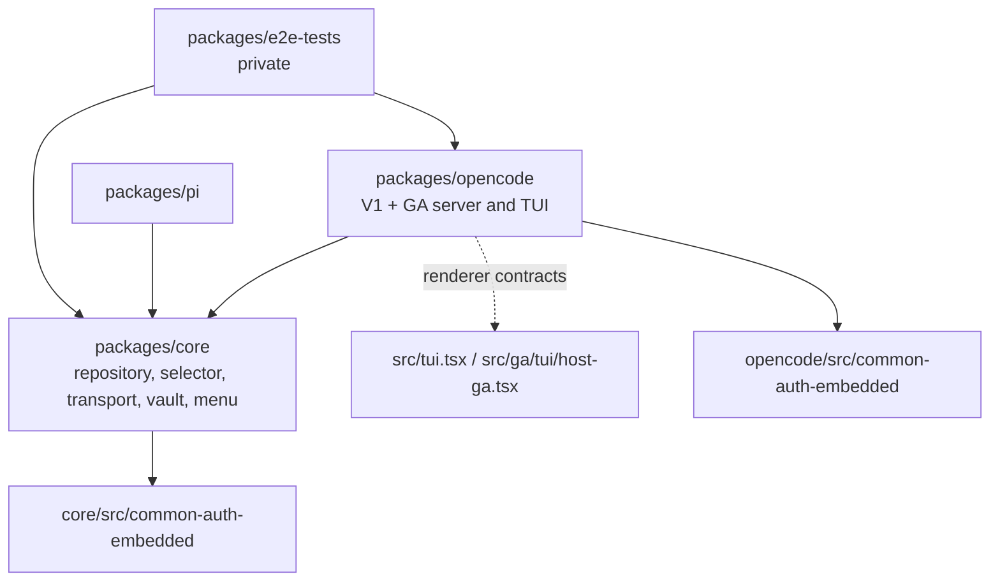

# Codebase Structure

This document maps the current tracked `@cortexkit/antigravity-auth*` sources: core, unified OpenCode, Pi, and private e2e validation. Generated output is identified separately; the manifests define package membership.

**Terminology:** V1 is OpenCode 1.x; GA is OpenCode 2's generally available plugin API. Local and vault sources mean disk-backed accounts and approved remote credentials respectively. Packed checks install tarballs into a consumer; native checks execute a real host. See [ARCHITECTURE.md](ARCHITECTURE.md) for source authorization, credential custody and lifecycle details.

The three publishable packages are `packages/core`, `packages/opencode` (V1/GA server and TUI entries) and `packages/pi`. Start here:

1. **`packages/core` owns harness-agnostic primitives.** Account repository/migration, selector, pool-file storage, quota, transport, OAuth, vault authority and lazy embedded common-auth capabilities live here; host SDK effects do not.
2. **`packages/opencode/index.ts` is the V1 barrel.** `src/plugin/index.ts` defines `createAntigravityPlugin`; `src/server.ts` is the hybrid `./server` default with V1 `server` and GA `id`/`setup`.
3. **`packages/opencode/src/ga/server/index.ts` is the GA composition root.** It rewrites host requests through a loopback bridge and uses `src/plugin/ga-location-services.ts`. V1 and GA use `src/plugin/shared/request-services.ts` within the same package.
4. **`packages/opencode/src/tui/entry.mjs` is the real hybrid `./tui` default.** It lazily dispatches V1 `tui` to `src/tui.tsx` output or GA `setup` to `src/ga/tui/host-ga.tsx` output. Renderers consume redacted contracts, not credential pipelines.
5. **`packages/pi/src/index.ts` synchronizes the native Google slot before registering a provider.** Startup failure installs a refusing provider and keeps `/antigravity` available for recovery.

## Repository tree

```
antigravity-auth/
├── AGENTS.MD                                # operator-facing agent manual
├── ARCHITECTURE.md                          # system-of-record architecture doc
├── STRUCTURE.md                             # this file — file-system map
├── README.md                                # project landing page
├── biome.jsonc                              # Biome formatter + linter config
├── bunfig.toml                              # Bun test preload (test/setup.ts + OpenTUI preload)
├── bun.lock                                 # Bun lockfile (committed)
├── lefthook.yml                             # pre-commit Biome check
├── mise.toml                                # Bun 1.3 + Node 24 toolchain pin
├── tsconfig.scripts.json                    # tsconfig for scripts/, test/, e2e-tests
├── package.json                             # root monorepo (npm workspaces: packages/*)
├── models                                   # JSON snapshot of upstream Antigravity model list
├── .github/                                 # GitHub config: workflows, issue templates, FUNDING
├── scripts/                                 # root build/dev/release/version-sync tooling
├── tools/common-auth-build/                  # frozen producer input and build-only dependencies
├── test/                                    # repo-root test preload + cross-package sanity tests
├── test-fixtures/                           # frozen Antigravity CLI JSON fixtures used by tests
└── packages/
    ├── core/                                # @cortexkit/antigravity-auth-core — harness-agnostic
    ├── opencode/                            # @cortexkit/opencode-antigravity-auth — V1 + GA server/TUI
    ├── pi/                                  # @cortexkit/pi-antigravity-auth — Pi extension
    └── e2e-tests/                           # private deterministic e2e workspace
```

`models` is a tracked upstream model snapshot; frozen wire fixtures live in `test-fixtures/`. OpenCode's four raw/compiled renderer trees are **gitignored** build output. By contrast, both `src/common-auth-embedded/` trees are tracked producer output, verified against common-auth 0.15.0 by the embedding scripts.

## Workspace responsibilities

| Workspace | Runtime responsibility | Imports from |
| --- | --- | --- |
| `packages/core` | OAuth, transport, selection, quota, lease repository/migration, pool-file storage, vault authority, shared menu. | Node built-ins, declared utility dependencies, embedded common-auth public modules; no host SDK. |
| `packages/opencode` | Unified V1/GA server/TUI, shared request executor, location services, menu and RPC. | Core, host-specific optional peers/types; V1 and GA renderer build profiles. |
| `packages/pi` | Pi extension — a custom OAuth provider that bridges Pi's `pi.registerProvider` API to the core transport + transforms. | `@cortexkit/antigravity-auth-core`, `@earendil-works/pi-*` (peer). |
| `packages/e2e-tests` | Private black-box flows against a mock Antigravity loopback server (`@cortexkit/antigravity-auth-e2e`, `private: true`). | `packages/opencode`, `packages/core`. |
| `scripts/` | Workspace-level tooling: dev symlink lifecycle, version sync, release script. | Node built-ins + child process. |
| `test/` | Preload + global types + a small handful of repo-root sanity tests (`environment.test.ts`, `dev.test.ts`). | Bun test harness. |
| `test-fixtures/` | Frozen JSON snapshots of captured `agy` CLI metadata and streaming requests, through version 1.1.24. | None. |
| `.github/` | Workflows (CI, release, issue triage), issue templates, FUNDING. | GitHub Actions. |

## `packages/core` inventory

The harness-agnostic core ships as `@cortexkit/antigravity-auth-core`. `src/index.ts` is its barrel; the manifest also exposes embedded `./common-auth/*` subpaths. It is the shared internal runtime dependency of OpenCode and Pi.

- `packages/core/bunfig.toml` — `preload = ["../../test/setup.ts"]`. Test isolation root.
- `packages/core/package.json` — declares `main`/`exports` on `./dist/`, lists runtime dependencies (`xdg-basedir`, `zod`).
- `packages/core/tsconfig.json` — library tsconfig (extends `@tsconfig/bun`).
- `packages/core/tsconfig.build.json` — emit + declaration tsconfig used by `bun run build` (`tsc -p tsconfig.build.json`).
- `packages/core/LICENSE`, `packages/core/README.md` — MIT + repo readme.

### Public surface (`packages/core/src/index.ts`)

- **`packages/core/src/account-manager.ts`** — account runtime over pool-file or repository persistence, delegating policy to the selector.
- **`packages/core/src/account-selector.ts`** — selection/rate-limit/session state and persistence transitions; `packages/opencode/src/plugin/config/schema.ts` defaults `account_selection_strategy` to hybrid, while `getCurrentOrNextForFamily` defaults an omitted argument to sticky.
- **`packages/core/src/account-repository.ts`** — attributed operations over common-auth's lease-backed store, per-account refresh locks, topology lease and management journal.
- `packages/core/src/account-repository-types.ts`, `account-repository-codecs.ts`, `account-identity.ts` — row/credential identities, provider metadata, codecs and write attribution.
- **`packages/core/src/account-migration.ts`** — journaled capture/build/verify/retire/activate migration beside a normalized absolute legacy path; explicit stopped-process/timer confirmation, pending/recovery outcomes on contention or lost ownership.
- **`packages/core/src/account-storage.ts`** — durable JSON shape `AccountStorageV4` with `accounts[]`, `activeIndex`, `activeIndexByFamily`; migration v1→v4; lock-held read-modify-write via the fenced file lock.
- **`packages/core/src/account-types.ts`** — pure types (`ManagedAccount`, `AccountSessionIdentity`, `RateLimitReason`, `CooldownReason`, `AccountStorageV4`).
- **`packages/core/src/agy-request-metadata.ts`** — `buildAgyAgentRequestMetadata` (the labels block — `last_step_index`, `model_enum`, `trajectory_id`, `used_claude*`, `used_non_gemini_model`) and the per-workspace `AgyRequestSessionStore` registry.
- **`packages/core/src/agy-transport.ts`** — raw HTTP/1.1 TLS transport with direct and HTTPS-proxy connections, chunked + gzip body decoding, response-header and idle-timeout watchdogs, immediate rejection when a peer closes before response headers, and socket-level `AbortSignal` propagation.
- **`packages/core/src/antigravity/oauth.ts`** — `authorizeAntigravity`, `exchangeAntigravity`, `refreshAntigravityToken`. Owns PKCE pack/unpack, the `51121` callback URL constant, and the client metadata header.
- **`packages/core/src/auth.ts`** — `parseRefreshParts`, `formatRefreshParts`, `accessTokenExpired` (60s buffer), refresh-token validity.
- **`packages/core/src/auth-types.ts`** — packed/refresh token wire types.
- **`packages/core/src/constants.ts`** — endpoints (`ANTIGRAVITY_ENDPOINT_FALLBACKS = [DAILY, PROD]`), scopes, request headers, sentinel values (`SKIP_THOUGHT_SIGNATURE`), `CLAUDE_TOOL_SYSTEM_INSTRUCTION`, OAuth prompt copy.
- **`packages/core/src/fetch-timeout.ts`** — `fetchWithActiveTimeout` (15s default header deadline, removed when headers resolve; caller cancellation remains attached until body EOF, error or cancellation).
- **`packages/core/src/file-lock.ts`** — renewable fenced lock for pool/sidebar paths, eviction markers, ownership assertion/loss signals and idempotent release. Pre/post-rename checks detect loss; rename is not compare-and-swap. Repository leases are a separate common-auth capability.
- **`packages/core/src/fingerprint.ts`** — per-account device fingerprint + fingerprint history persistence helpers.
- `packages/core/src/logger.ts` — structured logging primitives used by host composition and core modules.
- **`packages/core/src/model-registry.ts`** — canonical model definitions, quota groups and header-style metadata, re-exported by OpenCode's `src/plugin/model-registry.ts`.
- **`packages/core/src/model-types.ts`** — `QuotaGroupSummary`, family enum, header style enum, model specification types.
- **`packages/core/src/project.ts`** — `loadCodeAssist`, `ensureProjectContext`. Provisions the Antigravity `projectId` for an account.
- **`packages/core/src/quota-manager.ts`** — `QuotaManager`: per-account quota cache, exponential backoff, in-flight dedupe (`refreshAccount` returns the existing promise), disposal honours `AbortSignal`.
- **`packages/core/src/quota-types.ts`** — quota result shapes (`AccountQuotaResult`).
- **`packages/core/src/rotation.ts`** — `HealthScoreTracker`, `TokenBucketTracker`, `selectHybridAccount` (the hybrid scoring formula used by `account-manager.getCurrentOrNextForFamily`), `calculateBackoffMs`, `computeSoftQuotaCacheTtlMs`.
- **`packages/core/src/atomic-write.ts`** — temp-file + `rename` writer (mode `0o600`, no copy fallback); raw `node:fs` only.
- **`packages/core/src/version.ts`** — resolves the Antigravity client version from its updater API or changelog, with the constants fallback; it is not the npm package-version synchronizer.

- `packages/core/src/vault-enrollment-authority.ts` — selects local or vault accounts from fresh enrollment state and blocks local work while vault access is active or unreadable.
- `packages/core/src/vault-account-source.ts` — vault account discovery, fresh per-send credentials, and credential-free selection state. It never reads or refreshes the host's local Google login.
- `packages/core/src/quota-presentation.ts` — adapts Antigravity readings to common-auth's quota formatter without assigning an age to undated readings.
- `packages/core/src/vault-provider-state.ts`, `vault-family.ts` — credential-free vault provider/account state and family mapping.
- `packages/core/src/common-auth-runtime.ts` — lazy public store/fs/commands/auth-menu/routing/quota/claustrum/logger capability loaders and the embedded Pi-slot loader.
- `packages/core/src/antigravity-command-menu.ts` — shared `/antigravity` menu using common-auth commands and attributed account operations.
- `packages/core/src/common-auth-embedded/` — tracked common-auth 0.15.0 profile, including `NOTICE.txt` and `source-output.json`; regenerated only by its embedding owner.

### Transforms (`packages/core/src/transform/`)

- `packages/core/src/transform/index.ts` — barrel re-export of all transforms and types.
- `packages/core/src/transform/types.ts` — `TransformContext`, `TransformResult`, `ModelFamily`, `ThinkingTier`, `ResolvedModel`, `GoogleSearchConfig`, `ThinkingConfig`, `TransformDebugInfo`.
- `packages/core/src/transform/claude.ts` — `applyClaudeTransforms`, `appendClaudeThinkingHint`, `buildClaudeThinkingConfig`, `computeClaudeMaxOutputTokens`, `ensureClaudeMaxOutputTokens`, `isClaudeModel`, `isClaudeThinkingModel`, `normalizeClaudeTools`, `configureClaudeToolConfig`.
- `packages/core/src/transform/gemini.ts` — `applyGeminiTransforms`, `buildGemini3ThinkingConfig`, `buildGemini25ThinkingConfig`, `buildImageGenerationConfig`, `isGemini3Model`, `isGemini25Model`, `isGeminiModel`, `isImageGenerationModel`, `normalizeGeminiTools`, `toGeminiSchema`.
- `packages/core/src/transform/cross-model-sanitizer.ts` — payload cleanup before family switch (`sanitizeCrossModelPayload`, `sanitizeCrossModelPayloadInPlace`, `stripClaudeThinkingFields`, `stripGeminiThinkingMetadata`, `getModelFamily`).
- `packages/core/src/transform/model-resolver.ts` — `resolveModelWithTier`, `resolveAntigravityModel`, `resolveModelWithVariant`, `MODEL_ALIASES`, `GEMINI_3_THINKING_LEVELS`, `THINKING_TIER_BUDGETS`; resolves Antigravity wire models and thinking config, not a Gemini CLI request path.

### Co-located tests

Focused tests sit beside account/selector/repository/migration, transport, quota/presentation, vault and transform modules; not every source has a one-to-one test sibling. `bun run --cwd packages/core test` selects isolated source tests. These tests do not establish installed/native host readiness.

## `packages/opencode` inventory

`@cortexkit/opencode-antigravity-auth` exports `.`, `./server` and `./tui`. Its manifest declares `engines.opencode: '>=1.17.13 <2 || >=2.0.22'`. That declared range is not a measured host matrix. There is no inert TUI or public RPC compatibility subpath. Layout:

```
packages/opencode/
├── index.ts                                 # barrel: re-exports AntigravityCLIOAuthPlugin + GoogleOAuthPlugin
├── server.js / tui.js                        # tracked entry forwarders
├── assets/antigravity.schema.json           # generated JSON schema for the plugin config (built by script/build-schema.ts)
├── bunfig.toml                              # test preload
├── package.json                             # optional peerDependencies on @opencode-ai/plugin, @opentui/*, solid-js, typescript
├── tsconfig*.json                            # V1 library + GA type/emission profiles
├── docs/                                    # ANTIGRAVITY_API_SPEC, ARCHITECTURE, CONFIGURATION, MODEL-VARIANTS, MULTI-ACCOUNT, TROUBLESHOOTING
├── script/                                  # one-off CLI tests + the schema builder (see Root tooling and CI below)
├── scripts/                                 # renderer/library builder, embedding checks, packed-consumer smoke
├── src/                                     # all TypeScript source (see OpenCode TUI and RPC inventory below)
└── dist/                                    # build output (gitignored)
```

`src/tui-raw/`, `tui-compiled/`, `tui-ga-raw/` and `tui-ga-compiled/` are **gitignored** generated trees; `src/common-auth-embedded/` is tracked.

### Server plugin (`packages/opencode/src/`)

- `packages/opencode/index.ts` — top-level barrel re-exporting `AntigravityCLIOAuthPlugin` and `GoogleOAuthPlugin` from `plugin/index.ts`.
- `packages/opencode/src/server.ts` — hybrid `./server` default and named GA factory exports, compiled to `dist/server.js`.
- `packages/opencode/src/cli.ts` — standalone CLI binary entry (the `bin` field of `package.json`); the build step bundles it to `dist/cli.js`.
- `packages/opencode/src/antigravity/oauth.ts` — host-thin re-export / extension shim around `core/antigravity/oauth.ts` (used by the CLI's `OAuthLoginRequest`).
- `packages/opencode/src/constants.ts` — core re-export plus the single `/antigravity` menu command/title/section slots from credential-free `tui/host-api.ts`.
- `packages/opencode/src/shims.d.ts` — ambient type shims for host globals.
- `packages/opencode/src/sidebar-state.ts` — `SidebarStateV2` owner-only snapshot schema, v1-compatible reader, `setSidebarMachineState`, `mergeMachineState`, routing writes and drain. A renewable lock serializes cross-process merges; ownership is checked before atomic replacement. Known email is machine-only, labels stay ordinal, and precise fractions/reading times survive projection. See `packages/opencode/docs/sidebar-contract.md`.
- `packages/opencode/src/sidebar-projection.ts`, `quota-presentation.ts` — repository/source status projection and shared quota formatting; observation time stays distinct from publication/routing/tier clocks.
- `packages/opencode/src/tui-preferences.ts` — shared preferences reader/watcher for TUI settings (`tui-preferences.jsonc`, slot ordering, collapse, bar styling).
- `packages/opencode/src/rpc/` — the loopback HTTP RPC; see **OpenCode TUI and RPC inventory** below.

### Plugin composition root (`packages/opencode/src/plugin/`)

- **`packages/opencode/src/plugin/index.ts`** — V1 `createAntigravityPlugin(providerId, options)` composition root.
- `packages/opencode/src/plugin/types.ts` — `PluginInput`, `PluginContext`, `PluginResult`, `GetAuth`, host types.
- `packages/opencode/src/plugin/dependencies.ts` — `PluginDependencyOverrides` (the seam the e2e workspace uses to swap `fetchImpl`, `agyTransport`, `filesystemRoots`, `oauth`, `clock`) + `resolvePluginDependencies` default-resolver.
- `packages/opencode/src/plugin/lifecycle.ts` — tracked retirement keeps old managers until admitted refresh/request/body work drains. Final disposal publishes closing and a shared completion promise synchronously before hooks can reenter, aborts live/retiring work, stops producers, drains sidebar writes and then tears down consumers.
- `packages/opencode/src/plugin/auth-loader.ts` — fresh enrollment selects local/vault runtime; only authorized local work reads host auth/repairs drift/opens the repository. OpenCode 1 needs a saved `google` auth record to load the provider, but leaves ordinary logins and placeholders tied to other enrollments unread, unvalidated and unrefreshed while vault credentials serve. Checking which outgoing requests carry the Google placeholder belongs to OpenCode 2, not this loader.
- `packages/opencode/src/plugin/auth.ts` — token validation helpers used by the loader (refresh-parts checks, expiry buffer).
- `packages/opencode/src/plugin/auth-doctor.ts` — self-healing diagnostics for an unrecoverable auth store.
- `packages/opencode/src/plugin/auth-drift.ts` — `detectAuthStorageDrift`: compares the host's `getAuth()` result against the on-disk pool and surfaces a `restorable` path.
- `packages/opencode/src/plugin/accounts.ts` — host-side `AccountManager` factory. Stores pool via `packages/opencode/src/plugin/storage.ts`, exports `getCurrentOrNextForFamily`, `markAccountCoolingDown`, `markRateLimitedWithReason`.
- `packages/opencode/src/plugin/account-access.ts` — CLI-facing account prompts (`promptAccountIndexForVerification`, `promptOpenVerificationUrl`, `createAccountAccessService`).
- `packages/opencode/src/plugin/account-command-oauth.ts` — `createAccountCommandOAuthService`: manages pending OAuth state sessions for slash-command account additions.
- `packages/opencode/src/plugin/background-quota-refresh.ts` — `BackgroundQuotaRefresh`: background quota poller for idle accounts with 3-layer cross-process dedup (freshness gate, advisory lock, fail closed) and captured plan tier resolution.
- `packages/opencode/src/plugin/background-vault-quota-refresh.ts`, `vault-quota-refresh.ts`, `vault-sidebar-projection.ts` — OpenCode 1 vault-only abortable producer whose distinct renewable lock deduplicates checks across processes. Its freshness gate reads the oldest matching durable quota observation, never sidebar publication time; missing readings are due. Manual/automatic checks share sidebar publication after accepted quota writes, and projection uses the same account/route/credential match. No local credential refresh path.
- `packages/opencode/src/plugin/command-data.ts` — cache-only, privacy-safe account-row projection for account OAuth replies; the shared menu and repository collaborators own refresh and mutations.
- `packages/opencode/src/plugin/storage.ts` — host-path adapter and lease-repository opening/composition, plus pool-file compatibility operations and `.gitignore` synchronization.
- `packages/opencode/src/plugin/persist-account-pool.ts` — legacy JSON compatibility writer; current-store login persistence uses repository operations rather than rewriting the retired file.
- `packages/opencode/src/plugin/fetch-interceptor.ts` — V1 local/vault credential and host-effect bindings to the shared executor. Retirement refuses new generative requests and drains admitted work/bodies; final disposal aborts.
- `packages/opencode/src/plugin/shared/request-services.ts` — shared OpenCode 1/2 account selection, retries, Antigravity endpoint fallback, warmups, transforms and native error handling. Policy/unavailability can return native 401/412/502; exhausted transport throws or returns the saved upstream failure, never synthetic HTTP 200 assistant success.
- `packages/opencode/src/plugin/shared/runtime.ts`, `local-grant.ts`, `request-cancellation.ts`, `vault-request-credentials.ts`, `source-sidebar.ts`, `vault-menu.ts` — runtime/credential admission, cancellation, source projection and vault menu collaborators.
- `packages/opencode/src/plugin/fetch/retry-state.ts` — per-interceptor `RetryState` (rate-limit toast debounce, retry counts).
- `packages/opencode/src/plugin/fetch/warmup.ts` — `WarmupState` (probe accounts under load to detect soft-quota cliffs before they surprise the dispatcher).
- `packages/opencode/src/plugin/request.ts` — outbound transform pipeline (sanitize → resolve → inject metadata → order payload → harden).
- `packages/opencode/src/plugin/request-helpers.ts` — `cleanGenerativeLanguageRequest`, thinking-block filtering, tool-id orphan recovery glue.
- `packages/opencode/src/plugin/agy-request-metadata.ts` — host-side adapter around `core/agy-request-metadata.ts` with the session registry host binding.
- `packages/opencode/src/plugin/agy-transport.ts` — host-side adapter around `core/agy-transport.ts`; thin wrapper for the dependency-injected transport.
- `packages/opencode/src/plugin/transform/cross-model-sanitizer.ts` — host-side re-export of the core sanitizer (kept separate so a future OpenCode-specific override can fork without touching core).
- `packages/opencode/src/plugin/transform/model-resolver.ts` — host-side re-export.
- `packages/opencode/src/plugin/transform/types.ts` — host-side re-export.
- `packages/opencode/src/plugin/transform/index.ts` — host-side barrel.
- `packages/opencode/src/plugin/quota.ts` — `createOpenCodeQuotaManager` (the host wrapper over `core/quota-manager.ts`). Hands a `getAccountsForSidebar` closure to the core manager so quota refreshes push redacted sidebar snapshots.
- `packages/opencode/src/plugin/refresh-queue.ts` — `createProactiveRefreshQueue` — background timer that refreshes tokens before the access token expires.
- `packages/opencode/src/plugin/rotation.ts` — host thin wrapper around `core/rotation.ts`; pushes `initHealthTracker` and `initTokenTracker` per the user config.
- `packages/opencode/src/plugin/token.ts` — `refreshAccessToken` — called by the fetch interceptor when a token is within the 60s expiry buffer.
- `packages/opencode/src/plugin/oauth-methods.ts` — interactive OAuth menu (`Add another`, `Refresh`, `Check quotas`, `Verify accounts`, `Doctor`, `Manage`, `Cancel`); also drives `authorizeAntigravity` and `exchangeAntigravity` from core.
- `packages/opencode/src/plugin/oauth-login.ts` — `performOAuthLogin`: orchestrates the `startOAuthListener` + `exchangeAntigravity` flow for the CLI path.
- `packages/opencode/src/plugin/server.ts` — `startOAuthListener` (binds `http://localhost:51121` for the redirect, falls back to manual paste for headless / WSL2).
- `packages/opencode/src/plugin/catalog.ts` — `applyAntigravityProviderCatalog` + `registerAntigravityCommands` — handles `config.provider.*` and `config.command.*` injection.
- `packages/opencode/src/plugin/commands.ts`, `command-apply.ts` — single `/antigravity` command and OpenCode-specific settings/diagnostics sections over the shared common-auth menu; source-aware request path bindings.
- `packages/opencode/src/plugin/cli.ts` — small terminal prompts (`promptProjectId`, `promptAddAnotherAccount`) used by the OAuth method flow.
- `packages/opencode/src/plugin/ui/auth-menu.ts` — full-screen interactive auth menu renderer (`showAuthMenu`, `showAccountDetails`, `showFingerprintHistory`).
- `packages/opencode/src/plugin/ui/model-status.ts` — per-model quota status rendering helpers.
- `packages/opencode/src/plugin/ui/quota-status.ts` — quota summary rendering helpers.
- `packages/opencode/src/plugin/ui/select.ts` — primitive select-with-description list (kept free of the host's `hide-property` so invalid options stay visible).
- `packages/opencode/src/plugin/ui/confirm.ts` — primitive confirm dialog.
- `packages/opencode/src/plugin/ui/ansi.ts` — ANSI helpers shared by the UI primitives.
- `packages/opencode/src/plugin/event-handler.ts` — `createEventHandler` — host event hook (session.created / session.idle etc.).
- `packages/opencode/src/plugin/recovery.ts` — `createSessionRecoveryHook` — auto-recovers sessions from `tool_result_missing` errors.
- `packages/opencode/src/plugin/recovery/index.ts` — recovery subsystem barrel.
- `packages/opencode/src/plugin/recovery/types.ts` — recovery state types.
- `packages/opencode/src/plugin/recovery/constants.ts` — recovery limits (max attempts, retry delays).
- `packages/opencode/src/plugin/recovery/storage.ts` — durable on-disk state for in-flight recovery attempts.
- `packages/opencode/src/plugin/thinking-recovery.ts` — recovery for thinking-block signature mismatches (Gemini `skip_thought_signature_validator` path).
- `packages/opencode/src/plugin/killswitch.ts` — `evaluateKillswitchForAccount`, `throwIfAllKilled` — operator-tuned per-family/minimum-remaining-percent gate. Evaluation is model-aware via the `model`/`quotaModel` option: a `gemini-pro` request checks ONLY the `gemini-pro` quota group, not the max of pro+flash.
- `packages/opencode/src/plugin/operator-settings.ts` — `createOperatorSettingsController`: the runtime-mutable settings store (routing flags, killswitch, log level). Persists through the fenced-lock writer.
- `packages/opencode/src/plugin/config/schema.ts` — Zod schema for `antigravity.json` (the public config schema). Schema description source for `script/build-schema.ts`.
- `packages/opencode/src/plugin/config/loader.ts` — `loadConfig(directory)`, `loadConfigFile`. Computes the legacy Windows migration fallback. Swallows malformed JSON.
- `packages/opencode/src/plugin/config/writer.ts` — fenced-lock writer for the user config (used by the operator settings controller).
- `packages/opencode/src/plugin/config/updater.ts` — `updateOpencodeConfig` — generic writer helper for the host's opencode.json.
- `packages/opencode/src/plugin/config/models.ts` — type/catalog re-exports from the shared model registry.
- `packages/opencode/src/plugin/config/operator-settings-schema.ts` — Zod schema for the `operator.*` subtree.
- `packages/opencode/src/plugin/config/index.ts` — barrel for the config subtree; also calls `loadConfig` + `initRuntimeConfig`.
- `packages/opencode/src/plugin/cache/index.ts` — barrel for the cache subtree.
- `packages/opencode/src/plugin/cache.ts` — process-wide hot signature lookup and canonical-path disk-cache ownership. Locations retain/release their own persistence share; one location's disposal does not clear another's hot entries or signature store.
- `packages/opencode/src/plugin/cache/signature-cache.ts` — disk-backed cache for thinking-block signatures.
- `packages/opencode/src/plugin/stores/signature-store.ts` — `SignatureStore` persistence interface + memory-backed default.
- `packages/opencode/src/plugin/core/streaming/index.ts` — barrel for the streaming subsubsystem.
- `packages/opencode/src/plugin/core/streaming/transformer.ts` — the SSE reverse-transform: strips Antigravity envelope, splices `thoughtSignature`, aggregates `usageMetadata`, produces a `ReadableStream<Uint8Array>`.
- `packages/opencode/src/plugin/core/streaming/types.ts` — `SignatureStore`, `StreamingCallbacks`, `StreamingOptions`, `StreamingUsageMetadata`, `ThoughtBuffer`.
- `packages/opencode/src/plugin/debug.ts` — debug file logger for the server plugin (writes to the user-configured `log_dir`). Project IDs and fingerprint-form User-Agents are masked via `redactSensitive` before emission, and the logged request-body preview is field-redacted via `redactBodyForLog` so a project ID embedded in the body never leaks verbatim.
- `packages/opencode/src/plugin/errors.ts` — token refresh and killswitch domain errors; the loopback fetch guard's error belongs to the e2e workspace.
- `packages/opencode/src/plugin/fingerprint.ts` — host thin wrapper that pins the `FingerprintVersion` for an account.
- `packages/opencode/src/plugin/gemini-dump.ts` — request/response capture controlled by the `/antigravity` Diagnostics switch, not a separate `/gemini-dump` command. Session IDs and project IDs are masked via `maskIdentifier`; header User-Agents are redacted by `redactForDump`; the request body written to disk is field-redacted via `redactJsonBodyString` so project IDs embedded in the body are masked.
- `packages/opencode/src/plugin/google-search-tool.ts` — server-side `google_search` tool implementation.
- `packages/opencode/src/plugin/image-saver.ts` — writes Gemini image-generation output to disk and returns the file path back to the caller.
- `packages/opencode/src/plugin/logger.ts` — structured logger (`createLogger`, `initLogger`, `setRuntimeLogLevel`).
- `packages/opencode/src/plugin/logging-utils.ts` — small ANSI/console helpers plus `redactSensitive` / `redactSensitiveFields` (case-insensitive walk over `token|refresh|access|project|fingerprint|deviceId|sessionId|sessionToken|secret|password|apiKey|clientSecret` keys — `project` catches bare `project` / `managedProjectId` body fields), and `redactJsonBodyString` / `redactBodyForLog` which field-redact a serialized JSON request body before it reaches a debug log or dump file.
- `packages/opencode/src/plugin/model-registry.ts` — thin re-export of the core registry, not a second literal catalog.
- `packages/opencode/src/plugin/project.ts` — host thin wrapper around `core/project.ts`.
- `packages/opencode/src/plugin/prompt-context.ts` — extracts the active prompt context (workspace + system prompt) for cross-model sanitizer decisions.
- `packages/opencode/src/plugin/search.ts` — `executeSearch` Google Search grounding tool implementation.
- `packages/opencode/src/plugin/session-context.ts` — `AgySessionRegistry`, per-session `AgyRequestSessionStore` registration.
- `packages/opencode/src/plugin/version.ts` — runs once at plugin boot to publish the installed plugin version (used by the auto-update checker).
- `packages/opencode/src/plugin/host-api-compatibility.test.ts` — pins the opencode host SDK to a stable property subset (so a host bump that moves a name does not break us silently).

- `packages/opencode/src/plugin/ga-location-services.ts` — GA location-owned lazy local/vault bindings and menu/serving services. Fresh authority selects the source; switching enrollment preserves retained binding promises and RPC generation.
- `packages/opencode/src/plugin/vault-custody.ts`, `vault-activation.ts` — V1 enrollment/custody and activation callback. Activation requires vault authority and an absent own native `google` slot; it never overwrites an existing dormant record.

### Host lifecycle hooks

`packages/opencode/src/hooks/auto-update-checker/` — a self-contained module that runs in the background of the host:

- `packages/opencode/src/hooks/auto-update-checker/index.ts` — barrel; `createAutoUpdateCheckerHook` is the host-side hook entry point.
- `packages/opencode/src/hooks/auto-update-checker/checker.ts` — the actual update check: `npm view @cortexkit/opencode-antigravity-auth version` + auto-pin routine.
- `packages/opencode/src/hooks/auto-update-checker/cache.ts` — on-disk cache of the last known good version.
- `packages/opencode/src/hooks/auto-update-checker/constants.ts` — check interval, npm registry URL.
- `packages/opencode/src/hooks/auto-update-checker/logging.ts` — internal logger.
- `packages/opencode/src/hooks/auto-update-checker/types.ts` — types for the hook's report.

### Co-located OpenCode tests

Focused V1 tests include `src/plugin/auth-loader.test.ts`, `vault-activation.test.ts`, `fetch-interceptor.test.ts`, `lifecycle.test.ts` and `src/plugin-entry.test.ts`. GA tests live under `src/ga/` and alongside `plugin/ga-location-services.ts`; shared executor tests live under `src/plugin/shared/`. Sidebar, quota formatter, menu, RPC, TUI and build/pack-contract tests cover their own seams. The package `test` script selects `./src` and `./scripts/build-tui.test.ts` after embedding verification; root `test` adds other build/consumer contracts. Loader persistence tests model host behavior, not native sign-in UI.
## OpenCode TUI and RPC inventory

The V1 TUI polls a redacted snapshot and private loopback RPC; GA uses its location-scoped RPC contract. The hybrid entry chooses the matching renderer lazily.

### Sidebar snapshot

- `packages/opencode/src/sidebar-state.ts` — OpenCode 1 version-2 snapshot schema/reader/writer, merge and queued-write drain. Quota pools are `gemini | non-gemini` with stable `5h`/`weekly` windows and optional tier; quota observation, tier capture, routing update and machine publication timestamps remain distinct. Owner-only email never reaches renderer output. Ordinal labels exclude profile names; comparing cached and current account identity stamps prevents showing another account's quota after reordering.

### `packages/opencode/src/rpc/` — the loopback HTTP RPC

- `packages/opencode/src/rpc/protocol.ts` — type-only common-auth `CommandApplyRequest`, `CommandApplyResult`, `CommandDialogPayload` and `{ id, payload, sessionId? }` menu/toast notifications.
- `packages/opencode/src/rpc/rpc-server.ts` — embedded public RPC adapter; requires `parseApplyRequest` from the menu's commands module to validate action input and returns 400 for invalid bodies before dispatch. Configures 2-second receipt and 120-second apply deadlines; common-auth owns loopback/bearer/discovery/shutdown.
- `packages/opencode/src/rpc/rpc-client.ts` — `createRpcClient(dir, expectedPid)` — discovers the port file, posts JSON with `Authorization: Bearer <token>`, enforces a 2s default via `fetchWithActiveTimeout`.
- `packages/opencode/src/rpc/port-file.ts` — re-export of embedded public discovery; owner-only pid-scoped files carry the loopback port and fresh bearer.
- `packages/opencode/src/rpc/rpc-dir.ts` — `getRpcDir`: `ANTIGRAVITY_AUTH_RPC_DIR` env wins, else `<XDG_STATE_HOME>/cortexkit/antigravity-auth/rpc/<sha256(directory)[:16]>`.
- `packages/opencode/src/rpc/notifications.ts` — bounded queue (max 100 entries), `pushNotification`, `drainNotifications(lastReceivedId, sessionId?)`. `isTuiConnected` reflects whether the TUI polled within `CONNECTION_TTL_MS = 5000`.
- Tests: `notifications.test.ts`, `port-file.test.ts`, `rpc-client.test.ts`, `rpc-server.test.ts`.

### TUI render tree (`packages/opencode/src/tui/`, `packages/opencode/src/tui.tsx`)

- `packages/opencode/src/tui.tsx` — V1 sidebar slot; renders quota pools/windows and the selected session route, not one row for every session.
- `packages/opencode/src/tui/entry.mjs`, `entry.d.mts` — hybrid default `{ id, tui, setup }`. Embedded `loadTui` selects runtime-compiled output or the raw development fallback; unrelated import failures propagate.
- `packages/opencode/src/tui/host-v1.tsx`, `host-api.ts`, `vault-setup.ts` — V1 host bindings and credential-free setup/menu UI.
- `packages/opencode/src/tui/command-dialogs.tsx` — common-auth menu dialogs from RPC; server-side commands own confirmations/action dispatch.
- `packages/opencode/src/tui/file-logger.ts` — write-only file logger under `<xdg-state>/cortexkit/antigravity-auth/tui.log` (mode `0o600`, 1 MB tail-truncated). Parent dir is forced to `0o700` after every write and existing log files are re-`chmod`-ed to `0o600` to repair any leaked permissions. Never writes to stdout/stderr.
- `packages/opencode/src/tui-preferences.ts` — shared preferences reader/watcher for TUI layout and styling settings (`tui-preferences.jsonc`).
- Tests: `tui.test.tsx`, `tui-preferences.test.ts`, `tui-windows-frames.test.tsx`, `tui/command-dialogs.test.tsx`, `tui/file-logger.test.ts`.

## GA sources within `packages/opencode`

- `packages/opencode/src/ga/server/index.ts` — `createGaAntigravityPlugin`, request-hook/loopback job bridge, location lifetime and cleanup.
- `packages/opencode/src/ga/server/auth.ts` — pool browser login and approved-vault registration under the saved `Antigravity` connection label. OpenCode 2 handles outgoing requests carrying the host-prepared common-auth Google placeholder, not requests selected by connection metadata; see [OpenCode 2](packages/opencode/docs/OPENCODE-2.md). OpenCode 1's enrollment-only vault serving remains distinct.
- `packages/opencode/src/ga/proxy-guard.ts` — guarded loopback request boundary.
- `packages/opencode/src/ga/rpc/protocol.ts` — location-scoped snapshot/menu RPC.
- `packages/opencode/src/ga/tui/host-ga.tsx` — real GA renderer loaded by the hybrid TUI entry's `setup` arm.
- `packages/opencode/src/plugin/ga-location-services.ts` — lazy local repository/executor and vault service bindings; source changes refresh the selected view without rotating the RPC generation.
- `packages/opencode/tsconfig.ga.json`, `tsconfig.ga.emit.json` — genuine SDK typecheck and public declaration emission profiles.
- `packages/e2e-tests/src/opencode-ga-host-inputs.ts` — installed server-only SDK consumer profile. It selects `/server`, validates declaration/import targets and excludes installed TUI frameworks; this is not a GA-only package or inert TUI export.

## `packages/pi` inventory

`@cortexkit/pi-antigravity-auth`. A small extension that bridges the Pi runtime's `registerProvider` API to the core transport. Layout:

- `packages/pi/bunfig.toml` — `preload = ["../../test/setup.ts", "@opentui/solid/preload"]`. (OpenTUI preload is harmless here; the Pi extension itself does not use `@opentui/solid`.)
- `packages/pi/package.json` — declares `main` on `./dist/index.js`, `peerDependencies` on `@earendil-works/pi-*`, runtime dependency only on `@cortexkit/antigravity-auth-core`.
- `packages/pi/tsconfig.json`, `packages/pi/tsconfig.build.json` — library + build configs.
- `packages/pi/LICENSE`, `packages/pi/README.md` — MIT + readme.

### Source (`packages/pi/src/`)

- **`packages/pi/src/index.ts`** — async entry. A promise chain serializes locked native `google` slot synchronization; the entry rechecks enrollment mode before provider registration. Startup failure installs a refusing Google provider with no OAuth refresh path and keeps `/antigravity` for recovery. Source tests cover conflicts and synchronization ordering.
- `packages/pi/src/stream.ts` — `streamCortexKitAntigravity`: streams through `core/agy-transport.ts`, preserves signed thinking/tool events, and maintains session-scoped native AGY execution metadata.
- `packages/pi/src/convert.ts` — Pi Context-to-Gemini conversion with native AGY tool-call IDs, signature replay, cross-model sanitization, and same-target function-response roles.
- `packages/pi/src/vault-source.ts` — vault discovery and per-request credentials with fresh account-source checks.
- `packages/pi/src/vault-setup.ts` — enrollment, locked disconnect, vault account actions, and setup status.
- `packages/pi/src/commands.ts` — the shared `/antigravity` menu, omitting local credential-writing actions in vault mode.
- `packages/pi/src/credential-cache.ts` — stashes the packed `refreshToken|projectId|managedProjectId` triple so the stream can rejoin project context after the access token is stripped.
- `packages/pi/src/paths.ts` — resolves the `PI_AGENT_DIR` and `PI_ANTIGRAVITY_AUTH_FILE` paths on every platform (`%APPDATA%` on Windows, `~/.pi/agent/` elsewhere).
- `packages/pi/src/index.test.ts`, `convert.test.ts`, `credential-cache.test.ts`, `stream.test.ts` — co-located tests.

Pi's native marker ownership/restore rules are not V1's dormant-slot serving rule. The stream refuses wrong custody and obtains fresh vault credentials without local fallback. Shared quota presentation uses dated observations; undated readings do not receive a made-up age or reset.

## `packages/e2e-tests` inventory

`@cortexkit/antigravity-auth-e2e` — `private: true`, not published. Houses deterministic black-box flows against a mock Antigravity loopback server.

- `packages/e2e-tests/bunfig.toml` — `preload = ["./src/setup.ts"]`, `root = "./src"` so the e2e-runner only loads this workspace's tests.
- `packages/e2e-tests/tsconfig.json` — extends `@tsconfig/bun`.
- `packages/e2e-tests/package.json` — `private`, depends on `workspace:*` core + opencode packages.

### Source (`packages/e2e-tests/src/`)

- `packages/e2e-tests/src/setup.ts` — owned test roots/environment, in-process loopback-only fetch guard, scoped harness disposal/cleanup. This is not native child network containment.
- `packages/e2e-tests/src/harness.ts` — `E2eHarness`: builds a mock loopback server, a `PluginDependencyOverrides` bag that points the production plugin at `127.0.0.1`, and `createPlugin()` / `runCli()` helpers. The dependency-injected V1/CLI/RPC test seam; native GA/V1 harnesses have separate composition and containment.
- `packages/e2e-tests/src/fetch-router.ts` — `installFetchRouter` — routes `globalThis.fetch` through the mock when the URL targets the loopback server.
- `packages/e2e-tests/src/mock-antigravity-server.ts` — `startMockAntigravityServer` + `MockServerHandle`. Configurable routes, scripted responses, request recorder.
- `packages/e2e-tests/src/process-runner.ts` — `process-runner`: spawns the `antigravity-auth` CLI binary in a temp dir and pins stdout/stderr for assertions.
- `packages/e2e-tests/src/cli-flow.e2e.test.ts` — CLI flows (login, refresh, quota check) against the mock.
- `packages/e2e-tests/src/plugin-flow.e2e.test.ts` — full plugin instance lifecycle against the mock.
- `packages/e2e-tests/src/rpc-tui-flow.e2e.test.ts` — RPC server boot + notification drain end-to-end.
- `packages/e2e-tests/src/fetch-guard.test.ts` — pins the loopback-only `globalThis.fetch` guard: loopback URLs pass through, non-loopback URLs throw `LiveNetworkDeniedError`, the guard is restored in `afterEach`.
- `packages/e2e-tests/src/opencode-ga-harness.ts` — pinned packed/native GA host driver, owned child roots and explicit `OPENCODE_DB`, wire/error/lifecycle recording and containment checks.
- `packages/e2e-tests/src/opencode-ga-inputs.ts`, `opencode-ga-host-inputs.ts`, `fixtures/opencode-ga-host/` — current store fixtures, installed `/server` declaration/SDK profile and frozen host consumer inputs.
- `packages/e2e-tests/docker/run-opencode-ga-test.sh`, `opencode-ga/Dockerfile`, `ga-binary-pin.json` — committed-HEAD Linux/amd64 Docker gate with host/daemon native-architecture checks and `--network none`. Smoke selects terminal-frame; extended selects the broader driver.
- `packages/e2e-tests/docker/run-opencode-ga-native-test.sh` — explicitly admitted clean-tree native Linux-x64 preparation/execution with per-job hosts and network containment.
- `packages/e2e-tests/src/v1-vault-activation-harness.ts` — separate native V1 activation harness; no packed V1 readiness is implied by this file or source loader tests.
- `packages/e2e-tests/src/opencode-v2-harness.ts` — tracked auxiliary injected-host harness, not a published package or the root GA gate selector.
- Unit tests under this workspace: `mock-antigravity-server.test.ts`, `process-runner.test.ts`, `setup.cleanup.test.ts`.
- Run via `bun run test:e2e` at the repo root (delegates to `bun test --isolate ./packages/e2e-tests/src/plugin-flow.e2e.test.ts ./packages/e2e-tests/src/cli-flow.e2e.test.ts ./packages/e2e-tests/src/rpc-tui-flow.e2e.test.ts ./packages/e2e-tests/src/fetch-guard.test.ts ./packages/e2e-tests/src/mock-antigravity-server.test.ts`).

Root `test:e2e:opencode-v2` names the GA Docker smoke, `:extended` the broader driver, and `:local` admitted debugging. Source/injected tests, packed-consumer checks and native/Docker gates are distinct. Architecture, host/daemon and containment restrictions describe those gate profiles, not a universal host-support claim. Final CI, release, activation and packed/native readiness gates are evaluated independently; this map reports none as complete.

## Root tooling and CI

### `scripts/`

- `scripts/dev.ts` — builds core/OpenCode, creates the V1 bundle symlink at `.opencode/plugins/antigravity-auth.js`, then runs core `tsc --watch` and OpenCode `esbuild --watch`. `--check` still builds/links before verifying and removing the symlink; normal shutdown also removes it.
- `scripts/dev-clean.ts` — inverse of `dev.ts`; removes the development symlink.
- `scripts/version-sync.mjs` — synchronized version/core dependency pins for `packages/core`, `packages/opencode`, `packages/pi`; explicit semver, `--dry-run` and `--from-tag` (`GITHUB_REF_NAME`).
- `scripts/release.sh` — local release orchestration: semver/dry-run handling, runtime/build-tool preflight, embedding/typecheck/test/build, version sync, commit/tag/push. Before installing private compiler dependencies, it calls `bun packages/opencode/scripts/embed-common-auth.ts --check` to validate the current publication-qualified archive, inventory and source embeddings; the existing root `bun run embed:check` follows installation to check installed compiler prerequisites. This sequence describes the coordinated release contract, not completed verification or publication.
- `scripts/prepare-common-auth-public-consumer.ts`, `finalize-declaration-specifiers.ts` — isolated public-consumer test preparation and installed declaration-specifier finalization.

### `test/` (repo-root preload + sanity)

- `test/setup.ts` — installs `mkdtempSync` test root + env overrides on every package workspace, defines `globalThis.stubbed` / `unstubAllGlobals` / `freshImport`, and patches `jest.setSystemTime` / `jest.useRealTimers` to also spy on `Date.now()`.
- `test/global.d.ts` — type declarations for the helpers `test/setup.ts` installs.
- `test/environment.test.ts` — pins the env-isolation contract (`HOME`, `XDG_*`, `APPDATA`, `OPENCODE_CONFIG_DIR`, `PI_AGENT_DIR`, etc.).
- `test/dev.test.ts` — pins `scripts/dev.ts`'s `resolveDevPaths` / `createDevSymlink` / `removeDevSymlink` so a symlink-layout regression fails before the next release.
- `test-fixtures/agy-cli-1.1.3-model-metadata.json` and `test-fixtures/agy-cli-1.1.3-stream-request.json` — frozen snapshots of the upstream `agy` CLI for comparator tests.
- `test-fixtures/agy-cli-1.1.5-*`, `test-fixtures/agy-cli-1.1.6-*`, `test-fixtures/agy-cli-1.1.13-*`, and `test-fixtures/agy-cli-1.1.24-*` — versioned frozen wire snapshots.

### `tsconfig.scripts.json`

Project-wide tsconfig used by `bun run typecheck` (root script `typecheck`) for `scripts/**/*.ts`, `test/**/*.ts`, and `packages/e2e-tests/src/**/*.ts`.

### Root level

- `package.json` — embedding/build/typecheck/test/format/lint, packed TUI smoke, GA Docker smoke/extended/local commands and three package dry-run pack selectors. Exact commands live here, not in copied manifest snippets.
- `biome.jsonc` — formatter + linter config (`indent: 2 spaces`, `semicolons: asNeeded`, `quoteStyle: single`). Test files (`**/*.test.ts`) and `packages/opencode/src/plugin/ui/select.ts` carry override files that disable a small set of rules where the test naturally needs them.
- `bunfig.toml` — root: `preload = ["./test/setup.ts", "@opentui/solid/preload"]`.
- `lefthook.yml` — pre-commit: `biome check --staged --no-errors-on-unmatched` on `*.{ts,tsx,js,mjs,json,jsonc,yml,yaml}`.
- `mise.toml` — pins `bun = "1.3"` and `node = "24"`.
- `bun.lock` — committed; CI uses `bun install --frozen-lockfile`.
- `models` — tracked JSON snapshot of the upstream model inventory (referenced by the e2e tests for drift assertions).

### `.github/`

- `.github/workflows/ci.yml` — main/verify-branch push and main PR declarations: frozen install, direct embedding-coordinator check before each private compiler dependency install, root embedding check afterward, typecheck/build, TUI smoke, source/injected E2E, GA Docker smoke, format/lint; separate RPC runtime matrix.
- `.github/workflows/release.yml` — tag/manual declarations: checks and RPC matrix precede a serial core/OpenCode/Pi npm provenance publish matrix and GitHub Release. CI, this workflow and `scripts/release.sh` run `bun packages/opencode/scripts/embed-common-auth.ts --check` immediately before every `bun install --cwd tools/common-auth-build --frozen-lockfile --ignore-scripts`, then retain root `bun run embed:check` afterward. They use the coordinator's current publication-qualified input contract, not versioned archive-existence guards. Independent verification of this coordinated change is not reported as complete here.
- `.github/workflows/issue-triage.yml` — self-hosted Opencode Triage agent: parses label output, applies `bug`/`enhancement`/`documentation`/`question`/`invalid` + `area/auth`/`area/models`/`area/config`/`area/compat`, posts an automated reply, and closes duplicates.
- `.github/FUNDING.yml`, `.github/ISSUE_TEMPLATE/bug_report.yml`, `.github/ISSUE_TEMPLATE/feature_request.yml`, `.github/ISSUE_TEMPLATE/config.yml`.

## Entry points and package exports

| Package / surface | Source and exported target | Contract |
| --- | --- | --- |
| Core `.` | `packages/core/src/index.ts` → `dist/index.js` | Harness-agnostic barrel |
| Core primitive subpaths | `packages/core/src/account-identity.ts`, `file-lock.ts`, `atomic-write.ts`, `fetch-timeout.ts` → corresponding dist entries | Named public primitive exports |
| Core named `./common-auth/` subpaths | `packages/core/src/common-auth-embedded/` → matching `dist/common-auth-embedded/` entries | Public store/fs/routing/quota/commands/auth-menu/claustrum/logger exports; Pi-slot is accessed through the lazy root loader, not a manifest subpath |
| OpenCode `.` | `packages/opencode/index.ts` → `dist/index.js` | V1 `AntigravityCLIOAuthPlugin`, `GoogleOAuthPlugin` |
| OpenCode `./server` | `packages/opencode/src/server.ts` → `dist/server.js`; types `dist/types/src/server.d.ts` | Hybrid default: GA `id`/`setup`, V1 `server`; named `createGaAntigravityPlugin` |
| OpenCode `./tui` | `packages/opencode/src/tui/entry.mjs`; types `entry.d.mts` beside it | Hybrid default: `id`, V1 `tui`, GA `setup`; lazy real renderer roots |
| OpenCode CLI | `packages/opencode/src/cli.ts` → `dist/cli.js` | `bin.antigravity-auth` |
| Pi extension | `packages/pi/src/index.ts` → `dist/index.js` | Async default; `pi.extensions: ['./dist/index.js']` |

`packages/opencode/src/plugin/index.ts` and `src/ga/server/index.ts` are implementation composition roots, not additional public export-map subpaths. There is no exported `./rpc`. A test file is not a host entry. The GA server-only SDK fixture selects the installed `/server` API; it does not change either hybrid default.

## Generated and ignored artifacts

These directories exist at build time but are **gitignored** (see `.gitignore`). They are not part of the source tree:

- `node_modules/` — Bun-installed dependencies, workspace-wide. Ignored.
- `dist/` — core/OpenCode/Pi library, bundle and declaration output. Ignored; each manifest's `files` allowlist defines packing.
- Pack tarballs — output artifacts; the frozen producer tarball in `tools/common-auth-build/inputs/` is a tracked input, not disposable pack output.
- `coverage/`, `*.lcov`, `logs/`, `*.log`, `_.log`, `antigravity-debug-*.log` — coverage + log output. Ignored.
- `*.tsbuildinfo` — TypeScript incremental compile cache. Ignored.
- `.opencode/` — IDE + local OpenCode plugin dir. The root `.gitignore` ignores it; `scripts/dev.ts` makes `.opencode/plugins/antigravity-auth.js` a symlink during dev.
- Agent working directories: `.alfonso/`, `.cortexkit/`, `.hive/`, `.omo/`, `.opencode/`, `.pi/`, `.sisyphus/` — session state, model wire dumps, historian output, run continuation, and council runs. All ignored.
- `test-file.ts` — temporary scratch file used by the dev loop. Ignored.
- `package-lock.json` — npm optional-dep native-binary workaround. Ignored.

### Generated renderer trees and tracked producer output

`packages/opencode/scripts/build-tui.ts` delegates emission to `tools/common-auth-build/build.mjs` and verifies build-map inventories, byte counts and hashes. It produces:

| Source root | Raw output | Host-runtime output |
| --- | --- | --- |
| `packages/opencode/src/tui.tsx` | `packages/opencode/src/tui-raw/` | `packages/opencode/src/tui-compiled/` |
| `packages/opencode/src/ga/tui/host-ga.tsx` | `packages/opencode/src/tui-ga-raw/` | `packages/opencode/src/tui-ga-compiled/` |

The hybrid loader selects OpenCode 1's `tui` entry or OpenCode 2's `setup` entry, then common-auth `loadTui` chooses the compiled host-runtime renderer or the raw fallback. Expected runtime entries are `tui-compiled/tui.js` and `tui-ga-compiled/host-ga.js`, not mirrored `.tsx` paths. Build-TUI tests check import isolation and emission contracts; `packages/opencode/scripts/smoke-tui-pack-install.ts` checks installed packing separately. The package manifest's `files` allowlist is the shipping authority.

`packages/opencode/scripts/embed-common-auth.ts` pins `tools/common-auth-build/inputs/cortexkit-common-auth-0.15.0.tgz` and fixed public-module entry sets selected for OpenCode and core. `packages/core/scripts/embed-common-auth.ts` delegates the core profile. Both tracked `src/common-auth-embedded/` trees include provenance/notice files; do not hand-edit them. They differ from ignored renderer output. Root `embed:check` verifies them before build/typecheck/test/format/lint. Library builds copy embedded JS/declarations to dist, and OpenCode emits GA server declarations through `tsconfig.ga.emit.json` plus the declaration-specifier finalizer.

`packages/opencode/assets/antigravity.schema.json` is tracked generated schema from `script/build-schema.ts` and `src/plugin/config/schema.ts`, not an ignored renderer artifact.

## Naming and test conventions

- **Files / directories:** predominantly kebab-case; TypeScript/TSX sources coexist with JS/MJS build/embedded modules and fixtures.
- **Test files:** focused colocated `*.test.ts` / `*.test.tsx`, plus script/root tests and e2e flows. Use manifest selectors rather than assuming every source has a test sibling.
- **Types / interfaces:** `PascalCase` — `AccountManager`, `AntigravityConfig`, `SidebarStateV1`, `PluginResult`.
- **Functions / variables:** `camelCase` — `getCurrentOrNextForFamily`, `resolveModelWithTier`, `setSidebarMachineState`.
- **Constants:** `UPPER_SNAKE_CASE` — `ANTIGRAVITY_PROVIDER_ID`, `CLAUDE_TOOL_SYSTEM_INSTRUCTION`, `SKIP_THOUGHT_SIGNATURE`, `DEFAULT_AGY_RESPONSE_HEADER_TIMEOUT_MS`.
- **Test framework:** Bun's bundled isolated runner and `bun:test` helpers. Workspace-specific `bunfig.toml` selects the appropriate root or e2e preload; native hosts require additional child containment.
- **Assertion style:** `expect(actual).toBe(...)`, `.toEqual(...)`, `.toMatchObject(...)`; no third-party assertion library.
- **Test isolation env vars:** `ANTIGRAVITY_TEST_ROOT`, `HOME`, `USERPROFILE`, `XDG_CONFIG_HOME`, `XDG_CACHE_HOME`, `XDG_DATA_HOME`, `XDG_STATE_HOME`, `APPDATA`, `LOCALAPPDATA`, `OPENCODE_CONFIG_DIR`, `OPENCODE_ANTIGRAVITY_GEMINI_DUMP_DIR`, `PI_AGENT_DIR`, `PI_ANTIGRAVITY_AUTH_FILE`, `ANTIGRAVITY_AUTH_RPC_DIR`, `ANTIGRAVITY_AUTH_SIDEBAR_STATE_FILE`. Set automatically by `test/setup.ts`.
- **Formatting:** Biome 2.5.3, two-space indent, semicolons omitted, single quotes, trailing commas. The root runner is `bun run format:check` and `bun run lint`.

## Dependency-direction rules



- **Core has no OpenCode/Pi runtime SDK dependency.** Its public capabilities are host-agnostic and composed with injected effects.
- **V1 and GA are arms of one OpenCode package.** They share the request executor and core; host SDK imports/types and render roots remain host-specific.
- **Pi never imports OpenCode.** Its core/public common-auth capabilities and Pi peers form the integration boundary.
- **Server/render communication is through redacted contracts.** V1 uses file + RPC; GA uses location-scoped RPC. Build-TUI import-graph tests enforce credential isolation without assuming shared process memory.
- **Host tests use test-created profiles and databases.** HOME/XDG directories and database paths belong to the test, not the operator. Injected loopback fetch tests and packed/native network containment are separate evidence. No gate profile certifies architectures or hosts it did not exercise.

## Where to add code

Pick the path that lines up with the smallest possible blast radius. The list below is in the same shape as the verification gates.

- **New core primitive** (transport rule, persistence primitive, OAuth step): add or edit a file under `packages/core/src/`. Public surface changes go through `packages/core/src/index.ts`; co-locate a `*.test.ts` next to it. Type additions live in the matching `*-types.ts` file (e.g. `account-types.ts`, `auth-types.ts`, `model-types.ts`, `quota-types.ts`).
- **New model transform or sanitization rule:** `packages/core/src/transform/`. Add a focused export to `transform/index.ts` (or re-export `transform/types.ts` for the type). Update the focused test sibling; if the change touches model resolution, also update `transform/model-resolver.ts` and its `model-resolver.test.ts`.
- **New provider endpoint or sentinel value:** `packages/core/src/constants.ts`. If the value is per-account (overridable via config), the override goes in `packages/opencode/src/plugin/config/schema.ts` instead, and the fallback hard-codes the constant.
- **V1 host hook/lifecycle:** `packages/opencode/src/plugin/index.ts`, the focused subsystem and `plugin/lifecycle.ts`. Preserve tracked retirement and synchronous closing/reentry behavior.
- **Shared menu action:** `packages/core/src/antigravity-command-menu.ts`; OpenCode-specific sections in `plugin/commands.ts` / `command-apply.ts`, GA location services, or Pi `commands.ts`. Keep parser/menu instance ownership, confirmation, attribution, source authorization and renderer redaction aligned.
- **New sidebar field:** extend `SidebarStateV2` in `packages/opencode/src/sidebar-state.ts` and its writers; update `packages/opencode/docs/sidebar-contract.md` and focused tests. The snapshot is **owner-only**, contains optional email (PII), and must contain no tokens, project IDs or fingerprints. Only renderer-safe fields may be rendered; email stays out of text, logs and toasts.
- **RPC contract:** V1 `packages/opencode/src/rpc/` or GA `src/ga/rpc/protocol.ts`; preserve the embedded RPC/commands parsing boundary and authenticated loopback access.
- **New CLI command:** `packages/opencode/src/cli.ts` (the bundled CLI binary). Update `scripts/dev.ts` only if the new command affects the dev symlink lifecycle, which it should not. Co-locate a CLI-level test under `packages/e2e-tests/src/cli-flow.e2e.test.ts`.
- **GA behavior:** `packages/opencode/src/ga/server/`, `plugin/ga-location-services.ts` or the shared executor, with focused source tests and separate packed/native GA coverage. Keep SDK types out of runtime imports and host databases isolated.
- **New Pi behavior** (provider shape change, new path resolver, conversion rule): live under `packages/pi/src/`. The package surface is `src/index.ts`; stream adapters live in `src/stream.ts`; request/response converters live in `src/convert.ts`; path resolvers live in `src/paths.ts`. Co-locate a `*.test.ts` next to each.
- **Injected E2E fixture:** mock server and `E2eHarness` under `packages/e2e-tests/src/`; native/packed fixtures belong to their explicitly contained host harness instead.
- **Config field:** `packages/opencode/src/plugin/config/schema.ts`, runtime settings schema/menu where applicable, and generated `assets/antigravity.schema.json` via `build:schema`. Config defaulting is not a license to treat credential-store corruption as empty state.

## Change-together matrices

These are the file clusters where one logical change needs to touch more than one path. A coordinated change should land in the same PR.

| Change | Files that must move |
| --- | --- |
| Rename or change a core export | `packages/core/src/index.ts` + the source file + the per-file test + the re-exporter in `packages/opencode/src/plugin/transform/{index.ts,...}` (if it's a transform) + every `.test.ts` that imports the old name. |
| Add a new `@cortexkit/antigravity-auth-core` dependency in `packages/opencode` or `packages/pi` | Bump the published version, then re-run `scripts/version-sync.mjs` so dependents pick up the new pin. |
| Add a shared menu action | Core command menu + host sections + RPC/type-only renderer contract tests; common-auth's public `./commands` module owns action parsing and confirmations. |
| Change `SidebarStateV2` schema | `packages/opencode/src/sidebar-state.ts`, `docs/sidebar-contract.md`, `sidebar-projection.ts`, V1 renderer and focused tests; preserve renderer redaction, identity attribution and truthful timestamps. |
| Change a session-shape contract | `packages/core/src/agy-request-metadata.ts` (storage, `buildAgyAgentRequestMetadata`), `packages/opencode/src/plugin/agy-request-metadata.ts` (host adapter), `packages/opencode/src/plugin/session-context.ts` (registry), every `*.test.ts` that pins trajectory / labels. |
| Change an OAuth step | `packages/core/src/antigravity/oauth.ts` (the truth), `packages/opencode/src/antigravity/oauth.ts` (host re-export), `packages/opencode/src/plugin/server.ts` (callback listener), `packages/opencode/src/plugin/oauth-methods.ts` (UI flow), `packages/pi/src/index.ts` (Pi adapter — uses `authorizeAntigravity` + `exchangeAntigravity` directly). |
| Change the refresh queue cadence | `packages/core/src/auth.ts` (buffer), `packages/core/src/rotation.ts` (backoff), `packages/opencode/src/plugin/refresh-queue.ts` (cadence), the operator settings override in `config/operator-settings-schema.ts`, the dialog in `packages/opencode/src/plugin/commands.ts`. |
| Change the GA host contract | `packages/opencode/src/ga/`, location services, unified manifest/GA tsconfigs, focused source tests and installed `/server` SDK/native gates. |
| Bump a published package | Core/OpenCode/Pi manifests and dependency pins through `scripts/version-sync.mjs`; release orchestration/gates remain independently owned. |
| Change the loopback RPC contract | V1 RPC adapters or GA protocol, embedded public capability contract and renderer tests; do not hand-edit producer output. |
| Add a TUI-rendered field | Source projection/schema + appropriate V1/GA render root + import-graph/emission and packed-consumer checks. |
| Change repository/migration semantics | Core repository/types/codecs/identity/migration + host storage composition, source tests and attributed public-store consumer coverage. |

All content requests use Antigravity. Gemini CLI consumer service retired on June 18, 2026; old header-routing config keys are ignored. The Routing menu now describes account selection without header-style controls.
